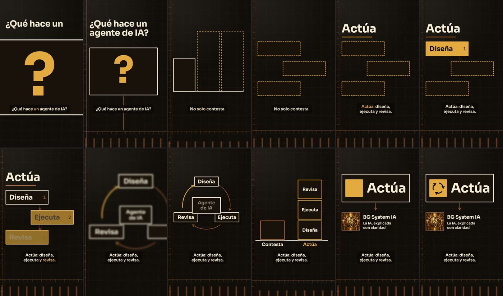
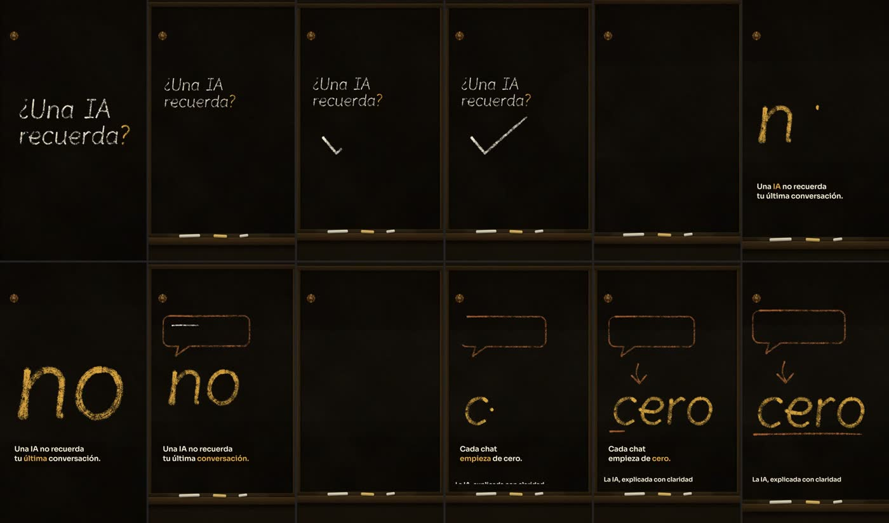

# Claqueta

Panel gratuito para dirigir videos hechos con código. Eliges estilo, duración, cámara, profundidad, montaje, voz y música, y sale un encargo completo que pegas en cualquier IA. Este repositorio trae lo que esa IA necesita para hacerlo, sin pagar API ni MCP.

**Abrir el panel:** https://berhjoan.github.io/claqueta


## Cómo se usa

1. **Elige.** Parte de una receta o recorre los departamentos: guion, arte, cámara, profundidad, movimiento, montaje, sonido, subtítulos, motor y entrega. El monitor muestra una previsualización mientras eliges.
2. **Copia.** «Copiar prompt» lo da en español. «Traducir y copiar» lo da en inglés y deja claro que todo el video va en español. El guion y el texto en pantalla nunca se traducen.
3. **Pega en tu IA.** Sirve cualquiera con terminal: Claude Code, Codex, Gemini CLI, Cursor. La IA clona este repositorio, sigue el encargo y entrega el video con lo que midió.

## Qué puedes configurar

| Departamento | Opciones |
|---|---|
| Estilo | 106 estilos con miniatura y ficha. Mezcla 70 / 20 / 10 |
| Cámara | 29 movimientos que puedes probar en el monitor, lente, encuadre, ángulo |
| Profundidad y luz | 2.5D, 3D, foco, atmósfera, luz |
| Movimiento | Curvas por rol, entradas de texto y de elementos |
| Montaje | Ritmo, sincronía, patrón, transiciones con receta, recursos |
| Voz | 21 voces gratis en español, con muestra para oír |
| Música | 8 caracteres con muestra, compuestos aquí, con el tiempo exacto de cada pulso |
| Subtítulos | Estilo, posición y frases |
| Línea de tiempo | Reordena, recorta y edita cada plano |
| Recetas | 12 puntos de partida completos |

## Qué trae para la IA

| Ruta | Qué hay |
|---|---|
| `AGENTS.md` | Reglas, orden de lectura y comandos |
| `library/guias/` | Dirección, motores, sonido, aprendizajes y diccionario de opciones |
| `library/hyperframes/` | Skills de HyperFrames 0.9.9 |
| `library/hyperframes-clasico/` | Flujos de HyperFrames 0.8.150 |
| `library/lemo-opuscar/` | 66 estilos de película, núcleo y técnica |
| `library/estilos-40/` | Atlas de 40 estilos |
| `engines/pizarra/` | Escritura a mano en tiza, en español |
| `tools/` | Voz, tiempos de palabra, música, efectos, mezcla y revisión |
| `data/` | Todo el catálogo como datos |
| `docs/radar.md` | 50 repositorios revisados, con licencia y veredicto |

## Sin pagar nada

| Trabajo | Herramienta | Costo |
|---|---|---|
| Video | HyperFrames, Canvas, three.js, ffmpeg | Gratis y local |
| Voz | Edge, Kokoro, Piper, Pocket TTS | Gratis. Edge pide internet y es un servicio no oficial |
| Música | `tools/audio/musica.py` | Gratis y local |
| Efectos | `tools/audio/efecto.py`, sfx-kit | Gratis y local |
| Tiempos de palabra | faster-whisper | Gratis y local |
| Este panel | GitHub Pages | Gratis |

La traducción de notas libres usa el traductor del navegador y, si no está listo, MyMemory, un servicio externo gratuito. El guion nunca sale de tu navegador por esa vía. Tus proyectos se guardan solo en tu navegador.

## Para probarlo o cambiarlo

No necesita compilar. Sirve la raíz con cualquier servidor estático:

```bash
python -m http.server 4173
```

```bash
npm test
```

```bash
node scripts/armar-biblioteca.mjs
```

```bash
node tools/prompt.mjs --receta pizarra --lang en
```

## Qué se probó y qué no

Dos IA nuevas, de un modelo más modesto que el que construyó esto y sin más contexto que el encargo, hicieron un video cada una. Estos cuadros son de esos videos, sin retocar:





Lo que encontraron se corrigió aquí mismo: rutas que no servían desde ninguna carpeta, una duración que contradecía al guion, tiempos de palabra con hasta 0,36 s de error y un motor de tiza que era más demo que motor. Después se repitió la cadena de comandos desde una carpeta limpia, pero no la prueba completa con otra IA.

También probado, en Windows 11 con un i5-11400T sin GPU dedicada: el panel en escritorio y teléfono, HyperFrames 0.9.9 con Canvas de `check` a `render`, los cuatro motores de voz y todas las herramientas de `tools/`. `npm test` corre 66 comprobaciones.

Falta el oído de una persona. Ninguna IA puede validar cómo suenan una voz, la música o la tiza: el sistema los mide y deja una muestra para que alguien la escuche. Tampoco se probaron Remotion, Motion Canvas ni Manim, que quedan como opciones del panel.

## Licencias

El código propio va bajo MIT. Lo copiado conserva su licencia, y `NOTICE.md` dice qué es cada cosa y qué se dejó fuera a propósito.
