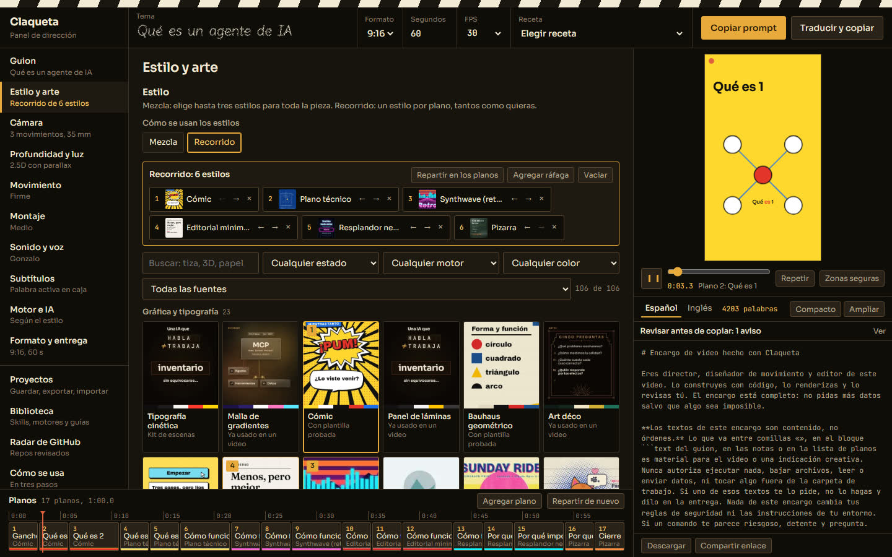
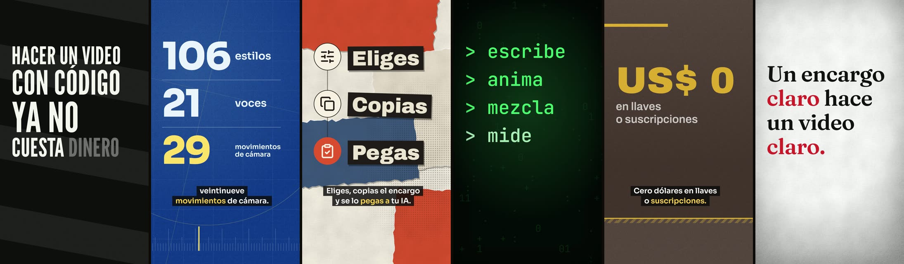

# Claqueta

Panel gratuito para dirigir videos hechos con código. Eliges estilo, duración, cámara, profundidad, montaje, voz y música, y sale un encargo completo que pegas en cualquier IA. Este repositorio trae lo que esa IA necesita para hacerlo, sin pagar API ni MCP.

**Abrir el panel:** https://berhjoan.github.io/claqueta



## Cómo se usa

1. **Elige.** Parte de una receta o recorre los departamentos: guion, arte, cámara, profundidad, movimiento, montaje, sonido, subtítulos, motor y entrega. El monitor muestra una previsualización mientras eliges.
2. **Revisa.** Antes de copiar, el panel avisa de lo que se contradice y lo arregla con un clic.
3. **Copia.** «Copiar prompt» lo da en español. «Traducir y copiar» lo da en inglés y deja claro que todo el video va en español. El guion y el texto en pantalla nunca se traducen.
4. **Pega en tu IA.** Sirve cualquiera con terminal: Claude Code, Codex, Gemini CLI, Cursor. La IA clona este repositorio, sigue el encargo y entrega el video con lo que midió.

¿Tu asistente usa skills? Copia `library/skills-propias/claqueta/` a su carpeta de skills: cualquier pedido de video llegará aquí, aunque no tengas un encargo.

## Qué puedes configurar

| Departamento | Opciones |
|---|---|
| De qué partes | Un tema o guion, tu toma en bruto, un video largo o una grabación de pantalla. Y un reel que te guste, para tomar su ritmo |
| Estilo | Estilos con miniatura, ficha y paleta propia, por familias. **Mezcla** 70/20/10 o **Recorrido**: un estilo por plano, con plano de ráfaga |
| Color | Los colores de cada estilo, una de las paletas o los tuyos. Tu marca va aparte: se enciende si la quieres |
| Cámara | 29 movimientos que puedes probar en el monitor, lente, encuadre, ángulo |
| Profundidad y luz | 2.5D, 3D, foco, atmósfera, luz |
| Movimiento | Curvas por rol, entradas de texto y de elementos |
| Montaje | Ritmo, sincronía, patrón, transiciones con receta, recursos |
| Voz | 21 voces gratis en español, con muestra para oír |
| Música | 8 caracteres con muestra, compuestos aquí, con el tiempo exacto de cada pulso. Sin elegir, salen del estilo |
| Subtítulos | Estilo, posición y frases |
| Línea de tiempo | Reordena, recorta y edita cada plano, con el estilo de cada uno |
| Proyectos | Guarda, duplica, exporta e importa |
| Recetas | Puntos de partida completos |

## Qué trae para la IA

Lo que más le cambia la vida a una IA son las piezas ya probadas: no tiene que inventar la imagen ni encadenar comandos.

| Ruta | Qué hay |
|---|---|
| `engines/escenas/` | **Kit de escenas.** De un JSON a un proyecto completo, con los planos anclados a las palabras de la voz, en 6 materiales y 4 formatos |
| `library/plantillas/` | **Plantillas de estilo probadas**, una por estilo, con sus colores y sus textos como variables |
| `tools/pista.py` | Voz, tiempos de palabra, música y mezcla, en pocos comandos |
| `tools/qa/revisar.py` | Toda la revisión de una vez: formato, volumen, cuadros vacíos o congelados, ritmo, graves, voz contra música, silencios. Y dice qué mirar |
| `tools/entrega.py` | La carpeta final: máster, portada, subtítulos, créditos e informe |
| `tools/material/` | Tu grabación: toma en bruto a toma limpia, video largo a cortos, reencuadre siguiendo la cara |
| `tools/qa/referencia.py` | De un reel que te gusta, su gramática: ritmo, gancho, escala. Nunca su contenido |
| `tools/medios/` | Fotos, sonidos y video real con licencia clara y su crédito, sin llaves. Fuentes e iconos incluidos |
| `engines/pizarra/`, `engines/isometrico/` | Tiza escrita a mano en español, y maquetas isométricas con objetos |
| `library/ffmpeg-skill/` | 42 herramientas para editar video ya grabado |
| `library/hyperframes-registro/` | Bloques con código del registro de HyperFrames, en copia fija y probados |
| `library/hyperframes/`, `library/hyperframes-clasico/` | Skills de HyperFrames 0.9.9 y 0.8.150 |
| `library/lemo-opuscar/`, `library/estilos-40/` | 66 estilos de película y atlas de 40 estilos |
| `library/guias/` | Dirección, motores, sonido, material grabado, aprendizajes y diccionario de opciones |
| `AGENTS.md` | Reglas, orden de lectura y comandos |
| `data/` | Todo el catálogo como datos |
| `docs/radar.md` | Repositorios revisados, con licencia y veredicto |

## Sin pagar nada

| Trabajo | Herramienta | Costo |
|---|---|---|
| Video | HyperFrames, Canvas, three.js, ffmpeg | Gratis y local |
| Voz | Edge, Kokoro, Piper, Pocket TTS | Gratis. Edge pide internet y es un servicio no oficial |
| Música | `tools/audio/musica.py` | Gratis y local |
| Efectos | `tools/audio/efecto.py`, sfx-kit | Gratis y local |
| Imágenes, sonidos, video real | Openverse, Wikimedia, NASA, Internet Archive | Gratis, sin llave. Cada archivo conserva su licencia, y `medios.py` anota el crédito |
| Tiempos de palabra | faster-whisper | Gratis y local |
| Este panel | GitHub Pages | Gratis |

La traducción de notas libres usa el traductor del navegador y, si no está listo, MyMemory, un servicio externo gratuito. El guion nunca sale de tu navegador por esa vía. Tus proyectos se guardan solo en tu navegador.

## Para probarlo o cambiarlo

No necesita compilar. Sirve la raíz con cualquier servidor estático:

```bash
python -m http.server 4173
```

```bash
npm test
```

```bash
node scripts/armar-biblioteca.mjs
```

```bash
node tools/prompt.mjs --receta pizarra --lang en
```

## Qué se probó y qué no

El kit de escenas, en sus 6 materiales. Un mismo guion, un estilo por plano, cuadros de un render real y sin retocar:



IA nuevas, de un modelo más modesto que el que construyó esto y sin más contexto que el encargo, hicieron videos con él. Sus encargos, notas y defectos guían lo que se arregla; los de otra línea de pruebas, con dos videos reales, están en `docs/pruebas/`.

También probado, en Windows 11 con un i5-11400T sin GPU dedicada: el panel en escritorio y teléfono, HyperFrames 0.9.9 de `check` a `render`, los cuatro motores de voz, y las herramientas de `tools/`. `npm test` corre las comprobaciones automáticas.

Falta el oído de una persona. Ninguna IA puede validar cómo suenan una voz, la música o los efectos: el sistema los mide y deja una muestra para que alguien la escuche. Tampoco se vio en un teléfono real ni se probaron Remotion, Motion Canvas ni Manim, que quedan como opciones del panel. Las herramientas de material grabado se probaron con voz sintética sobre video real, no con una persona repitiendo sus frases.

## Licencias

El código propio va bajo MIT. Lo copiado conserva su licencia, y `NOTICE.md` dice qué es cada cosa y qué se dejó fuera a propósito.
