# Atlas de estilos de video para Claude

40 estilos · 80 prompts · referencias visuales

Edición 1.0 · 13 de octubre de 2026

## Cómo usar esta guía

Este catálogo sirve para dirigir a Claude Opus 5.5 en la creación y edición de videos de cualquier temática. Contiene 20 estilos identificados en el video proporcionado y 20 ampliaciones editoriales. Los códigos S01-S40 son estables: puedes pedir un estilo por su número, nombre o imagen de referencia.

Empieza adjuntando GUIA_ESTILOS_CLAUDE.md y CATALOGO_ESTILOS.json. Para mayor fidelidad adjunta también la imagen del estilo elegido, cuando exista (S21 a S40). El atlas en PDF no se publica aquí; el Markdown contiene las instrucciones completas para el agente. No es necesario cargar las 40 fichas en cada encargo: bastan la instrucción general y las fichas seleccionadas.

Ejemplo de orden: «Edita mi video con S21 como base editorial, S07 para las tres frases importantes y S24 para señalar detalles. Mantén la voz y el orden de los hechos. Entrega una versión de 30 segundos y el proyecto editable».

Esta guía aporta contexto y reglas reutilizables; no entrena ni modifica los pesos del modelo. Su persistencia depende de que la conserves en el contexto o documentación del agente. No instala herramientas ni demuestra por sí sola que tu entorno pueda renderizar todos los efectos.

Variables de los prompts: [TEMA], [TEXTO], [ARCHIVO], [TRAMO] y [OBJETO]. Sustitúyelas antes de ejecutar. Si faltan duración o formato, usar como propuesta inicial 8 segundos, 1080 × 1920 y 30 fps, salvo que el material requiera conservar su cadencia. Los números de las recetas son puntos de partida, no mediciones del original.

## Qué se observó en el video

Se analizó un video público de 37,67 s, en 512 × 910 y 30 fps. Las descripciones de S01 a S20 salen de ese análisis.

El encabezado visible dice «20 crazy Claude animation styles (that you can steal)» y la marca visible es @MILLEE.MD. No se ha verificado la autoría fuera del archivo. Las capturas de ese video no se incluyen en este repositorio porque pertenecen a su autor; aquí solo queda la descripción de cada estilo.

El análisis se basa en una revisión visual secuencial de fotogramas cada 0,5 s y capturas de detalle. Los tiempos de las fichas son aproximados y no constituyen una lista de edición precisa al fotograma. No se ha transcrito el audio; las propuestas sonoras de esta guía son sugerencias, no afirmaciones sobre la banda sonora original.

Los nombres S01-S20 se leen en la lista del propio video. Las descripciones indican lo visible. Las implementaciones, duraciones y parámetros son recetas propuestas para reproducir el lenguaje visual: el video no prueba qué software, código, prompt ni versión del modelo se utilizó.

Hay tres capas diferentes: estilo de diseño (Bauhaus, art déco), representación o material (wireframe, arcilla, semitono) y comportamiento temporal (morphing, split-flap, animación tipográfica). Puedes combinarlas si defines qué función cumple cada una. S21-S40 amplían el catálogo; sus ilustraciones son esquemas originales de identificación, no fotogramas del video ni renders finales de esos estilos.

## Qué hace Claude y qué debe renderizar otra herramienta

La documentación oficial presenta Opus 5.5 como un modelo para programación, agentes y tareas visuales. En esta guía su función es interpretar el encargo, diseñar escenas, escribir código o instrucciones de edición y operar las herramientas disponibles. La creación de un MP4 requiere un motor de render o un editor; disponer del modelo no demuestra que ese motor esté conectado.

Ruta A, gráficos precisos: usar SVG, Canvas o componentes de video para títulos, datos, diagramas y máscaras. Remotion permite componer y renderizar videos programados. Es una ruta propuesta, no una dependencia obligatoria del catálogo.

Ruta B, volumen real: usar Three.js o Blender cuando importen geometría, iluminación, cámara, sombras y materiales. Para una superposición sencilla sobre footage, un compositor 2D suele bastar.

Ruta C, imagen generativa: recurrir a un generador externo únicamente cuando haga falta material que no pueda obtenerse del archivo original ni construirse con gráficos. Claude prepara el prompt y revisa continuidad; el texto exacto, cifras y logotipos conviene componerlos como capas controladas.

Ruta D, montaje: un editor o FFmpeg organiza los clips y combina imagen, títulos, música y subtítulos. La documentación de filtros de FFmpeg incluye overlay y transiciones; los ejemplos avanzados requieren revisar los formatos, tiempos y codecs del material.

Antes de producir, el agente debe inventariar las herramientas realmente disponibles, comprobar un render corto y declarar cualquier limitación. No afirmar que «ya se creó el video» cuando solo se escribió un prompt. No instalar ni contratar un servicio nuevo sin que el encargo o las preferencias del usuario lo autoricen.

## Sistema de selección y mezcla

Elige primero el objetivo: explicar, emocionar, presentar, entretener o llamar a la acción. Después asigna un estilo principal al conjunto, uno secundario a elementos concretos y, si hace falta, un acento a una transición. Como punto de partida, dedicar aproximadamente 70 % de presencia visual al principal, 20 % al secundario y 10 % al acento; es una regla editorial flexible, no un cálculo de tiempo obligatorio.

Para entrevistas: S21 editorial + S07 tipografía + S24 anotaciones. Para explicación técnica: S18 blueprint + S05 wireframe + S26 infografía. Para una apertura artística: S03 holográfico + S11 gradientes. Para nostalgia: S14 VHS + S29 synthwave, recordando que uno es tratamiento y el otro dirección artística. Para un relato cálido: S22 collage + S23 parallax + S30 película.

El estilo debe servir al relato. Un gráfico de datos conserva cifras y escalas aunque use neón. Un rostro conserva sus proporciones aunque lleve una anotación. Un nombre propio conserva ortografía aunque sea cinético. La animación no debe crear una afirmación que el video no contiene.

Prueba de reconocimiento: ocultar la etiqueta y comprobar si se identifican dos o tres rasgos propios del estilo. Si S06 solo parece un rectángulo transparente, falta relación con el fondo. Si S13 solo cambia letras, falta la bisagra. Si S15 solo tiene ruido, falta una trama ordenada.

Intensidad sugerida: baja para contenido hablado; media para gráficos de explicación; alta para una apertura corta. Se puede cambiar color, forma y tema sin perder el estilo, pero conviene conservar al menos dos de sus rasgos distintivos.

## Flujo de producción para un agente

1. Inspeccionar el archivo: resolución, fps, duración, orientación, pistas de audio, variación de luz, planos y espacios libres. Si hay voz, transcribirla con una herramienta disponible y revisar nombres, cifras y cortes. Si no puede escucharla, declararlo.

2. Crear una lista de escenas con inicio, fin, texto exacto, asset, estilo, movimiento, transición y propósito. No elegir cortes por un muestreo visual aproximado cuando se necesita sincronía labial.

3. Preparar un fotograma de estilo y una muestra de 3-5 segundos. Comprobar legibilidad a tamaño de teléfono y funcionamiento real del render. Continuar sin aprobaciones intermedias innecesarias si el encargo ya autoriza producir.

4. Construir por capas: footage base; corrección de color; recorte o seguimiento; gráficos; texto; grano o acabado. El texto y los subtítulos suelen mantenerse por encima de tratamientos que afectarían su legibilidad.

5. Animar con tiempo explícito. En código, derivar t de frame/fps y usar semillas estables. Evitar relojes del sistema y aleatoriedad nueva por fotograma. Precargar fuentes y recursos; hacer que inicio, mitad y final puedan renderizarse de manera aislada.

6. Montar sonido: conservar la voz, reducir música durante el diálogo y colocar efectos puntuales donde ayuden a entender la acción. Comprobar sincronía y ausencia de clipping. Usar música y material que se pueda utilizar en el destino previsto.

7. Revisar un render final completo, además de fotogramas de muestra. Verificar el último frame, duración de audio, bordes, subtítulos, saltos, loops y continuidad. Entregar el MP4, fuentes editables y una breve relación de lo aplicado y de cualquier limitación.

## Índice de estilos

| Código | Estilo | Fuente |
|---|---|---|

| S01 | Partículas / Particles | 0.0-1.3 s aprox. |

| S02 | Morphing líquido / Liquid morph | 1.3-3.0 s aprox. |

| S03 | Holográfico / Holographic | 3.0-4.4 s aprox. |

| S04 | Resplandor neón / Neon glow | 4.4-5.9 s aprox. |

| S05 | Malla 3D / Wireframe 3D | 5.9-7.8 s aprox. |

| S06 | Cristal esmerilado / Glassmorphism | 7.8-9.1 s aprox. |

| S07 | Tipografía cinética / Kinetic type | 9.1-10.8 s aprox. |

| S08 | Isométrico / Isometric | 10.8-12.7 s aprox. |

| S09 | Arcilla 3D / Clay 3D | 12.7-14.4 s aprox. |

| S10 | Arte ASCII / ASCII art | 14.4-16.8 s aprox. |

| S11 | Malla de gradientes / Gradient mesh | 16.8-18.4 s aprox. |

| S12 | Cómic / Comic book | 18.4-19.8 s aprox. |

| S13 | Panel de láminas / Split-flap | 19.8-21.7 s aprox. |

| S14 | Retro VHS | 21.7-23.6 s aprox. |

| S15 | Semitono / Halftone | 23.6-25.2 s aprox. |

| S16 | Bauhaus geométrico | 25.2-26.8 s aprox. |

| S17 | Pixel art | 26.8-28.6 s aprox. |

| S18 | Plano técnico / Blueprint | 28.6-30.2 s aprox. |

| S19 | Art déco / Art deco | 30.2-31.8 s aprox. |

| S20 | Neobrutalismo / Neo-brutalism | 31.8-33.5 s aprox. |

| S21 | Editorial minimalista | Ampliación |

| S22 | Collage de papel | Ampliación |

| S23 | Parallax 2.5D | Ampliación |

| S24 | Doodle / Anotación dibujada | Ampliación |

| S25 | Line art / Trazo continuo | Ampliación |

| S26 | Infografía animada | Ampliación |

| S27 | HUD / Interfaz de ciencia ficción | Ampliación |

| S28 | Glitch digital | Ampliación |

| S29 | Synthwave / Retrofuturismo | Ampliación |

| S30 | Película analógica | Ampliación |

| S31 | Stop motion / Animación por poses | Ampliación |

| S32 | Cel shading / Cartoon 3D | Ampliación |

| S33 | Low poly | Ampliación |

| S34 | Vóxel / Voxel | Ampliación |

| S35 | Tinta y acuarela | Ampliación |

| S36 | Producto de estudio / Macro 3D | Ampliación |

| S37 | Siluetas y contraluz | Ampliación |

| S38 | Doble exposición | Ampliación |

| S39 | Datamosh simulado | Ampliación |

| S40 | Pizarra / Chalkboard | Ampliación |

## S01 · Partículas / Particles

**Observado en el video** · Procedural · 0.0-1.3 s aprox.

### Cómo reconocerlo

Nube de puntos rosados sobre violeta oscuro que se concentra y abre una figura radial.

### Receta de movimiento

Distribuir 1200 puntos con semilla fija; atraerlos hacia una silueta entre 0 y 2 s; sostener 2 s; dispersar en 1 s. Variar tamaño entre 2 y 6 px a 1080p.

### Cuándo aplicarlo

Revelación de título, apertura científica, atmósfera y acento detrás de una persona.

### Cómo implementarlo

Canvas 2D para puntos planos; Three.js para profundidad. Interpolar posiciones con ruido continuo y evitar aleatoriedad nueva por fotograma.

### Ejemplo concreto

Una nube dibuja una estrella y revela el título DESCUBRE.

### Evitar

Confeti sin intención; partículas sobre ojos o letras; destellos que oculten el texto.

### Prompt para crear

Crea una escena sobre [TEMA] en estilo S01, Partículas / Particles. Usa esta dirección visual: Nube de puntos rosados sobre violeta oscuro que se concentra y abre una figura radial. Sustituye el contenido de muestra por [OBJETO] y el texto exacto [TEXTO]. Movimiento: Distribuir 1200 puntos con semilla fija; atraerlos hacia una silueta entre 0 y 2 s; sostener 2 s; dispersar en 1 s. Variar tamaño entre 2 y 6 px a 1080p. Organiza entrada, desarrollo y cierre para una duración inicial de 8 s. Implementación propuesta: Canvas 2D para puntos planos; Three.js para profundidad. Interpolar posiciones con ruido continuo y evitar aleatoriedad nueva por fotograma. Entrega un render y las fuentes editables si el entorno dispone del motor necesario. Conserva el texto como capa exacta.

### Prompt para editar

Edita [ARCHIVO], en [TRAMO], aplicando S01, Partículas / Particles. Objetivo: Revelación de título, apertura científica, atmósfera y acento detrás de una persona. Adapta este comportamiento al plano: Distribuir 1200 puntos con semilla fija; atraerlos hacia una silueta entre 0 y 2 s; sostener 2 s; dispersar en 1 s. Variar tamaño entre 2 y 6 px a 1080p. Conserva la voz, identidad, hechos y continuidad. Decide si corresponde overlay, tratamiento, transición o reconstrucción; explica cualquier recurso faltante. Mantén libres rostro, subtítulos e información esencial. Usa [TEXTO] solo donde ayude al mensaje. Revisa una muestra en movimiento y luego el archivo final.

### Comprobación

Comprobar estos rasgos: Nube de puntos rosados sobre violeta oscuro que se concentra y abre una figura radial. Verificar además lectura, estabilidad temporal, fidelidad del contenido y ausencia de estos defectos: Confeti sin intención; partículas sobre ojos o letras; destellos que oculten el texto.

## S02 · Morphing líquido / Liquid morph

**Observado en el video** · Material y forma · 1.3-3.0 s aprox.

### Cómo reconocerlo

Volúmenes redondeados brillantes se fusionan y separan sobre un fondo gris claro.

### Receta de movimiento

Animar dos o tres masas con trayectorias suaves; aproximar centros, formar un cuello y separar. Reservar 1 s final para una silueta estable.

### Cuándo aplicarlo

Transiciones orgánicas, transformación de conceptos, aperturas de producto.

### Cómo implementarlo

Metaballs o campos de distancia en Blender/Three.js; morph targets cuando la topología coincida. Un filtro SVG permite una aproximación plana.

### Ejemplo concreto

Tres gotas se unen en una esfera que descubre un producto.

### Evitar

Fundir caras, logos o texto por accidente; cambios bruscos de topología; llamarlo simulación física si es una aproximación.

### Prompt para crear

Crea una escena sobre [TEMA] en estilo S02, Morphing líquido / Liquid morph. Usa esta dirección visual: Volúmenes redondeados brillantes se fusionan y separan sobre un fondo gris claro. Sustituye el contenido de muestra por [OBJETO] y el texto exacto [TEXTO]. Movimiento: Animar dos o tres masas con trayectorias suaves; aproximar centros, formar un cuello y separar. Reservar 1 s final para una silueta estable. Organiza entrada, desarrollo y cierre para una duración inicial de 8 s. Implementación propuesta: Metaballs o campos de distancia en Blender/Three.js; morph targets cuando la topología coincida. Un filtro SVG permite una aproximación plana. Entrega un render y las fuentes editables si el entorno dispone del motor necesario. Conserva el texto como capa exacta.

### Prompt para editar

Edita [ARCHIVO], en [TRAMO], aplicando S02, Morphing líquido / Liquid morph. Objetivo: Transiciones orgánicas, transformación de conceptos, aperturas de producto. Adapta este comportamiento al plano: Animar dos o tres masas con trayectorias suaves; aproximar centros, formar un cuello y separar. Reservar 1 s final para una silueta estable. Conserva la voz, identidad, hechos y continuidad. Decide si corresponde overlay, tratamiento, transición o reconstrucción; explica cualquier recurso faltante. Mantén libres rostro, subtítulos e información esencial. Usa [TEXTO] solo donde ayude al mensaje. Revisa una muestra en movimiento y luego el archivo final.

### Comprobación

Comprobar estos rasgos: Volúmenes redondeados brillantes se fusionan y separan sobre un fondo gris claro. Verificar además lectura, estabilidad temporal, fidelidad del contenido y ausencia de estos defectos: Fundir caras, logos o texto por accidente; cambios bruscos de topología; llamarlo simulación física si es una aproximación.

## S03 · Holográfico / Holographic

**Observado en el video** · Material · 3.0-4.4 s aprox.

### Cómo reconocerlo

Anillo ondulado con bandas iridiscentes arcoíris sobre fondo claro.

### Receta de movimiento

Rotar lentamente un anillo irregular; desplazar la iluminación y la fase del color. Cámara estable; el reflejo cambia con la orientación.

### Cuándo aplicarlo

Identidad futurista, arte digital, moda, acentos de tecnología.

### Cómo implementarlo

Three.js con iridiscencia o shader; Blender con material iridiscente. Un gradiente animado es una alternativa gráfica, no holografía física.

### Ejemplo concreto

Un aro iridiscente enmarca el título NUEVA PERSPECTIVA.

### Evitar

Arcoíris en todo el plano; texto ilegible; confundir iridiscencia con una proyección holográfica real.

### Prompt para crear

Crea una escena sobre [TEMA] en estilo S03, Holográfico / Holographic. Usa esta dirección visual: Anillo ondulado con bandas iridiscentes arcoíris sobre fondo claro. Sustituye el contenido de muestra por [OBJETO] y el texto exacto [TEXTO]. Movimiento: Rotar lentamente un anillo irregular; desplazar la iluminación y la fase del color. Cámara estable; el reflejo cambia con la orientación. Organiza entrada, desarrollo y cierre para una duración inicial de 8 s. Implementación propuesta: Three.js con iridiscencia o shader; Blender con material iridiscente. Un gradiente animado es una alternativa gráfica, no holografía física. Entrega un render y las fuentes editables si el entorno dispone del motor necesario. Conserva el texto como capa exacta.

### Prompt para editar

Edita [ARCHIVO], en [TRAMO], aplicando S03, Holográfico / Holographic. Objetivo: Identidad futurista, arte digital, moda, acentos de tecnología. Adapta este comportamiento al plano: Rotar lentamente un anillo irregular; desplazar la iluminación y la fase del color. Cámara estable; el reflejo cambia con la orientación. Conserva la voz, identidad, hechos y continuidad. Decide si corresponde overlay, tratamiento, transición o reconstrucción; explica cualquier recurso faltante. Mantén libres rostro, subtítulos e información esencial. Usa [TEXTO] solo donde ayude al mensaje. Revisa una muestra en movimiento y luego el archivo final.

### Comprobación

Comprobar estos rasgos: Anillo ondulado con bandas iridiscentes arcoíris sobre fondo claro. Verificar además lectura, estabilidad temporal, fidelidad del contenido y ausencia de estos defectos: Arcoíris en todo el plano; texto ilegible; confundir iridiscencia con una proyección holográfica real.

## S04 · Resplandor neón / Neon glow

**Observado en el video** · Luz · 4.4-5.9 s aprox.

### Cómo reconocerlo

Texto NEON y marcos luminosos cian y magenta en un túnel oscuro.

### Receta de movimiento

Encender el contorno en 0,3 s, revelar el título en 0,5 s y mover marcos en profundidad. Mantener un núcleo nítido bajo el halo.

### Cuándo aplicarlo

Intros nocturnas, música, eventos y rótulos breves.

### Cómo implementarlo

SVG/CSS con capas desenfocadas o compositor con bloom; Three.js si la cámara viaja por un túnel real.

### Ejemplo concreto

El título EN VIVO aparece entre dos marcos de luz azul.

### Evitar

Blancos quemados, halo que borra letras, parpadeo constante y abuso del magenta.

### Prompt para crear

Crea una escena sobre [TEMA] en estilo S04, Resplandor neón / Neon glow. Usa esta dirección visual: Texto NEON y marcos luminosos cian y magenta en un túnel oscuro. Sustituye el contenido de muestra por [OBJETO] y el texto exacto [TEXTO]. Movimiento: Encender el contorno en 0,3 s, revelar el título en 0,5 s y mover marcos en profundidad. Mantener un núcleo nítido bajo el halo. Organiza entrada, desarrollo y cierre para una duración inicial de 8 s. Implementación propuesta: SVG/CSS con capas desenfocadas o compositor con bloom; Three.js si la cámara viaja por un túnel real. Entrega un render y las fuentes editables si el entorno dispone del motor necesario. Conserva el texto como capa exacta.

### Prompt para editar

Edita [ARCHIVO], en [TRAMO], aplicando S04, Resplandor neón / Neon glow. Objetivo: Intros nocturnas, música, eventos y rótulos breves. Adapta este comportamiento al plano: Encender el contorno en 0,3 s, revelar el título en 0,5 s y mover marcos en profundidad. Mantener un núcleo nítido bajo el halo. Conserva la voz, identidad, hechos y continuidad. Decide si corresponde overlay, tratamiento, transición o reconstrucción; explica cualquier recurso faltante. Mantén libres rostro, subtítulos e información esencial. Usa [TEXTO] solo donde ayude al mensaje. Revisa una muestra en movimiento y luego el archivo final.

### Comprobación

Comprobar estos rasgos: Texto NEON y marcos luminosos cian y magenta en un túnel oscuro. Verificar además lectura, estabilidad temporal, fidelidad del contenido y ausencia de estos defectos: Blancos quemados, halo que borra letras, parpadeo constante y abuso del magenta.

## S05 · Malla 3D / Wireframe 3D

**Observado en el video** · Representación 3D · 5.9-7.8 s aprox.

### Cómo reconocerlo

Nudo violeta dibujado como malla de líneas y girando sobre una cuadrícula.

### Receta de movimiento

Rotar 25 grados por segundo en un eje principal; añadir inclinación leve. Grosor de línea estable y malla de densidad moderada.

### Cuándo aplicarlo

Despieces, tecnología, procesos de construcción y visualización de geometría.

### Cómo implementarlo

Three.js o Blender con malla/edges. Ajustar densidad y antialiasing a la resolución final.

### Ejemplo concreto

Un objeto pasa de estructura de alambre a superficie sólida.

### Evitar

Malla tan densa que produce moiré; perspectiva deformada; líneas subpíxel.

### Prompt para crear

Crea una escena sobre [TEMA] en estilo S05, Malla 3D / Wireframe 3D. Usa esta dirección visual: Nudo violeta dibujado como malla de líneas y girando sobre una cuadrícula. Sustituye el contenido de muestra por [OBJETO] y el texto exacto [TEXTO]. Movimiento: Rotar 25 grados por segundo en un eje principal; añadir inclinación leve. Grosor de línea estable y malla de densidad moderada. Organiza entrada, desarrollo y cierre para una duración inicial de 8 s. Implementación propuesta: Three.js o Blender con malla/edges. Ajustar densidad y antialiasing a la resolución final. Entrega un render y las fuentes editables si el entorno dispone del motor necesario. Conserva el texto como capa exacta.

### Prompt para editar

Edita [ARCHIVO], en [TRAMO], aplicando S05, Malla 3D / Wireframe 3D. Objetivo: Despieces, tecnología, procesos de construcción y visualización de geometría. Adapta este comportamiento al plano: Rotar 25 grados por segundo en un eje principal; añadir inclinación leve. Grosor de línea estable y malla de densidad moderada. Conserva la voz, identidad, hechos y continuidad. Decide si corresponde overlay, tratamiento, transición o reconstrucción; explica cualquier recurso faltante. Mantén libres rostro, subtítulos e información esencial. Usa [TEXTO] solo donde ayude al mensaje. Revisa una muestra en movimiento y luego el archivo final.

### Comprobación

Comprobar estos rasgos: Nudo violeta dibujado como malla de líneas y girando sobre una cuadrícula. Verificar además lectura, estabilidad temporal, fidelidad del contenido y ausencia de estos defectos: Malla tan densa que produce moiré; perspectiva deformada; líneas subpíxel.

## S06 · Cristal esmerilado / Glassmorphism

**Observado en el video** · Interfaz y material · 7.8-9.1 s aprox.

### Cómo reconocerlo

Tarjetas translúcidas con bordes claros sobre manchas de color; cambian cifras y controles.

### Receta de movimiento

Entrar tarjetas con desfase de 0,12 s, desplazamiento de 24 px y escala de 0,96 a 1. Fondo lento; texto estable.

### Cuándo aplicarlo

Datos sobre video, demostraciones de interfaces, fichas de información.

### Cómo implementarlo

HTML/CSS o compositor: desenfocar la copia del fondo bajo la máscara, añadir tinte y borde. Verificar que el renderer capture el blur.

### Ejemplo concreto

Tres tarjetas muestran nombre, tema y duración de una entrevista.

### Evitar

Tarjetas transparentes sin contraste; desenfocar letras; cristales que parecen plástico opaco.

### Prompt para crear

Crea una escena sobre [TEMA] en estilo S06, Cristal esmerilado / Glassmorphism. Usa esta dirección visual: Tarjetas translúcidas con bordes claros sobre manchas de color; cambian cifras y controles. Sustituye el contenido de muestra por [OBJETO] y el texto exacto [TEXTO]. Movimiento: Entrar tarjetas con desfase de 0,12 s, desplazamiento de 24 px y escala de 0,96 a 1. Fondo lento; texto estable. Organiza entrada, desarrollo y cierre para una duración inicial de 8 s. Implementación propuesta: HTML/CSS o compositor: desenfocar la copia del fondo bajo la máscara, añadir tinte y borde. Verificar que el renderer capture el blur. Entrega un render y las fuentes editables si el entorno dispone del motor necesario. Conserva el texto como capa exacta.

### Prompt para editar

Edita [ARCHIVO], en [TRAMO], aplicando S06, Cristal esmerilado / Glassmorphism. Objetivo: Datos sobre video, demostraciones de interfaces, fichas de información. Adapta este comportamiento al plano: Entrar tarjetas con desfase de 0,12 s, desplazamiento de 24 px y escala de 0,96 a 1. Fondo lento; texto estable. Conserva la voz, identidad, hechos y continuidad. Decide si corresponde overlay, tratamiento, transición o reconstrucción; explica cualquier recurso faltante. Mantén libres rostro, subtítulos e información esencial. Usa [TEXTO] solo donde ayude al mensaje. Revisa una muestra en movimiento y luego el archivo final.

### Comprobación

Comprobar estos rasgos: Tarjetas translúcidas con bordes claros sobre manchas de color; cambian cifras y controles. Verificar además lectura, estabilidad temporal, fidelidad del contenido y ausencia de estos defectos: Tarjetas transparentes sin contraste; desenfocar letras; cristales que parecen plástico opaco.

## S07 · Tipografía cinética / Kinetic type

**Observado en el video** · Tipografía · 9.1-10.8 s aprox.

### Cómo reconocerlo

Las palabras MAKE, IT y MOVE ocupan el plano con cambios de escala, fondo y repetición.

### Receta de movimiento

Asignar una palabra clave por golpe; entrada de 6 a 10 fotogramas a 30 fps; pausa de lectura de 0,7 a 1,2 s; salida por máscara.

### Cuándo aplicarlo

Subtítulos expresivos, frases de apertura, manifiestos y llamadas a la acción.

### Cómo implementarlo

Remotion o SVG para tipografía exacta; medir cajas de texto y sincronizar con marcas reales de la voz.

### Ejemplo concreto

PIENSA / CREA / COMPARTE en tres composiciones consecutivas.

### Evitar

Animar cada sílaba sin jerarquía; cortar palabras; deformar letras; mostrar más de una idea dominante.

### Prompt para crear

Crea una escena sobre [TEMA] en estilo S07, Tipografía cinética / Kinetic type. Usa esta dirección visual: Las palabras MAKE, IT y MOVE ocupan el plano con cambios de escala, fondo y repetición. Sustituye el contenido de muestra por [OBJETO] y el texto exacto [TEXTO]. Movimiento: Asignar una palabra clave por golpe; entrada de 6 a 10 fotogramas a 30 fps; pausa de lectura de 0,7 a 1,2 s; salida por máscara. Organiza entrada, desarrollo y cierre para una duración inicial de 8 s. Implementación propuesta: Remotion o SVG para tipografía exacta; medir cajas de texto y sincronizar con marcas reales de la voz. Entrega un render y las fuentes editables si el entorno dispone del motor necesario. Conserva el texto como capa exacta.

### Prompt para editar

Edita [ARCHIVO], en [TRAMO], aplicando S07, Tipografía cinética / Kinetic type. Objetivo: Subtítulos expresivos, frases de apertura, manifiestos y llamadas a la acción. Adapta este comportamiento al plano: Asignar una palabra clave por golpe; entrada de 6 a 10 fotogramas a 30 fps; pausa de lectura de 0,7 a 1,2 s; salida por máscara. Conserva la voz, identidad, hechos y continuidad. Decide si corresponde overlay, tratamiento, transición o reconstrucción; explica cualquier recurso faltante. Mantén libres rostro, subtítulos e información esencial. Usa [TEXTO] solo donde ayude al mensaje. Revisa una muestra en movimiento y luego el archivo final.

### Comprobación

Comprobar estos rasgos: Las palabras MAKE, IT y MOVE ocupan el plano con cambios de escala, fondo y repetición. Verificar además lectura, estabilidad temporal, fidelidad del contenido y ausencia de estos defectos: Animar cada sílaba sin jerarquía; cortar palabras; deformar letras; mostrar más de una idea dominante.

## S08 · Isométrico / Isometric

**Observado en el video** · Proyección · 10.8-12.7 s aprox.

### Cómo reconocerlo

Plataforma de cubos turquesa y violeta que suben y bajan en niveles.

### Receta de movimiento

Cámara ortográfica fija; escalonar la altura de cubos en una onda de 0,08 s por pieza. Sombras suaves y tres caras distinguibles.

### Cuándo aplicarlo

Explicar sistemas, módulos, redes, espacios y procesos.

### Cómo implementarlo

Blender/Three.js con cámara ortográfica o SVG de tres caras. Para isometría estricta, usar ejes con igual escala proyectada.

### Ejemplo concreto

Cinco módulos se ensamblan para explicar un flujo de trabajo.

### Evitar

Perspectiva cambiante; cubos que atraviesan otros; caras con luz contradictoria.

### Prompt para crear

Crea una escena sobre [TEMA] en estilo S08, Isométrico / Isometric. Usa esta dirección visual: Plataforma de cubos turquesa y violeta que suben y bajan en niveles. Sustituye el contenido de muestra por [OBJETO] y el texto exacto [TEXTO]. Movimiento: Cámara ortográfica fija; escalonar la altura de cubos en una onda de 0,08 s por pieza. Sombras suaves y tres caras distinguibles. Organiza entrada, desarrollo y cierre para una duración inicial de 8 s. Implementación propuesta: Blender/Three.js con cámara ortográfica o SVG de tres caras. Para isometría estricta, usar ejes con igual escala proyectada. Entrega un render y las fuentes editables si el entorno dispone del motor necesario. Conserva el texto como capa exacta.

### Prompt para editar

Edita [ARCHIVO], en [TRAMO], aplicando S08, Isométrico / Isometric. Objetivo: Explicar sistemas, módulos, redes, espacios y procesos. Adapta este comportamiento al plano: Cámara ortográfica fija; escalonar la altura de cubos en una onda de 0,08 s por pieza. Sombras suaves y tres caras distinguibles. Conserva la voz, identidad, hechos y continuidad. Decide si corresponde overlay, tratamiento, transición o reconstrucción; explica cualquier recurso faltante. Mantén libres rostro, subtítulos e información esencial. Usa [TEXTO] solo donde ayude al mensaje. Revisa una muestra en movimiento y luego el archivo final.

### Comprobación

Comprobar estos rasgos: Plataforma de cubos turquesa y violeta que suben y bajan en niveles. Verificar además lectura, estabilidad temporal, fidelidad del contenido y ausencia de estos defectos: Perspectiva cambiante; cubos que atraviesan otros; caras con luz contradictoria.

## S09 · Arcilla 3D / Clay 3D

**Observado en el video** · Material 3D · 12.7-14.4 s aprox.

### Cómo reconocerlo

Esfera rosa, cubo azul y aro amarillo con bordes blandos y sombras sobre suelo pastel.

### Receta de movimiento

Dar un rebote moderado y rotación lenta a cada figura, desfasados; compresión de 3 a 6 % al tocar el suelo.

### Cuándo aplicarlo

Contenido amable, aprendizaje, conceptos sencillos y productos creativos.

### Cómo implementarlo

Blender o Three.js: geometría biselada, material mate, luz grande y oclusión de contacto.

### Ejemplo concreto

Una esfera salta sobre tres bloques que representan pasos.

### Evitar

Brillo metálico; sombras duras; deformación gomosa excesiva; objetos flotando sin apoyo.

### Prompt para crear

Crea una escena sobre [TEMA] en estilo S09, Arcilla 3D / Clay 3D. Usa esta dirección visual: Esfera rosa, cubo azul y aro amarillo con bordes blandos y sombras sobre suelo pastel. Sustituye el contenido de muestra por [OBJETO] y el texto exacto [TEXTO]. Movimiento: Dar un rebote moderado y rotación lenta a cada figura, desfasados; compresión de 3 a 6 % al tocar el suelo. Organiza entrada, desarrollo y cierre para una duración inicial de 8 s. Implementación propuesta: Blender o Three.js: geometría biselada, material mate, luz grande y oclusión de contacto. Entrega un render y las fuentes editables si el entorno dispone del motor necesario. Conserva el texto como capa exacta.

### Prompt para editar

Edita [ARCHIVO], en [TRAMO], aplicando S09, Arcilla 3D / Clay 3D. Objetivo: Contenido amable, aprendizaje, conceptos sencillos y productos creativos. Adapta este comportamiento al plano: Dar un rebote moderado y rotación lenta a cada figura, desfasados; compresión de 3 a 6 % al tocar el suelo. Conserva la voz, identidad, hechos y continuidad. Decide si corresponde overlay, tratamiento, transición o reconstrucción; explica cualquier recurso faltante. Mantén libres rostro, subtítulos e información esencial. Usa [TEXTO] solo donde ayude al mensaje. Revisa una muestra en movimiento y luego el archivo final.

### Comprobación

Comprobar estos rasgos: Esfera rosa, cubo azul y aro amarillo con bordes blandos y sombras sobre suelo pastel. Verificar además lectura, estabilidad temporal, fidelidad del contenido y ausencia de estos defectos: Brillo metálico; sombras duras; deformación gomosa excesiva; objetos flotando sin apoyo.

## S10 · Arte ASCII / ASCII art

**Observado en el video** · Representación · 14.4-16.8 s aprox.

### Cómo reconocerlo

Volumen rotatorio verde reconstruido mediante caracteres sobre fondo negro.

### Receta de movimiento

Renderizar primero la escena base; reducir a rejilla de caracteres; mapear luminancia a una rampa ordenada y conservar el giro suave.

### Cuándo aplicarlo

Introducciones de programación, ciberestética y transiciones de datos.

### Cómo implementarlo

Canvas: muestrear luminancia por celda y dibujar glifos monoespaciados. Compensar proporción de celda de la fuente.

### Ejemplo concreto

Un retrato autorizado aparece como caracteres y vuelve al video original.

### Evitar

Caracteres aleatorios que no describen la forma; texto final diminuto; ruido temporal.

### Prompt para crear

Crea una escena sobre [TEMA] en estilo S10, Arte ASCII / ASCII art. Usa esta dirección visual: Volumen rotatorio verde reconstruido mediante caracteres sobre fondo negro. Sustituye el contenido de muestra por [OBJETO] y el texto exacto [TEXTO]. Movimiento: Renderizar primero la escena base; reducir a rejilla de caracteres; mapear luminancia a una rampa ordenada y conservar el giro suave. Organiza entrada, desarrollo y cierre para una duración inicial de 8 s. Implementación propuesta: Canvas: muestrear luminancia por celda y dibujar glifos monoespaciados. Compensar proporción de celda de la fuente. Entrega un render y las fuentes editables si el entorno dispone del motor necesario. Conserva el texto como capa exacta.

### Prompt para editar

Edita [ARCHIVO], en [TRAMO], aplicando S10, Arte ASCII / ASCII art. Objetivo: Introducciones de programación, ciberestética y transiciones de datos. Adapta este comportamiento al plano: Renderizar primero la escena base; reducir a rejilla de caracteres; mapear luminancia a una rampa ordenada y conservar el giro suave. Conserva la voz, identidad, hechos y continuidad. Decide si corresponde overlay, tratamiento, transición o reconstrucción; explica cualquier recurso faltante. Mantén libres rostro, subtítulos e información esencial. Usa [TEXTO] solo donde ayude al mensaje. Revisa una muestra en movimiento y luego el archivo final.

### Comprobación

Comprobar estos rasgos: Volumen rotatorio verde reconstruido mediante caracteres sobre fondo negro. Verificar además lectura, estabilidad temporal, fidelidad del contenido y ausencia de estos defectos: Caracteres aleatorios que no describen la forma; texto final diminuto; ruido temporal.

## S11 · Malla de gradientes / Gradient mesh

**Observado en el video** · Fondo · 16.8-18.4 s aprox.

### Cómo reconocerlo

Campos de color cian, coral, violeta y azul se desplazan como manchas blandas.

### Receta de movimiento

Mover cuatro focos de color lentamente durante 6 s; interpolar posiciones con ruido suave y limitar cambios de luminosidad.

### Cuándo aplicarlo

Fondos de títulos, pausas visuales y presentaciones de marca.

### Cómo implementarlo

Shader de campo de color o múltiples gradientes radiales; añadir dithering leve si aparece banding.

### Ejemplo concreto

Un fondo cálido se enfría lentamente al cambiar de capítulo.

### Evitar

Confundirlo con líquido 3D; colores que reducen contraste; manchas muy rápidas detrás de texto.

### Prompt para crear

Crea una escena sobre [TEMA] en estilo S11, Malla de gradientes / Gradient mesh. Usa esta dirección visual: Campos de color cian, coral, violeta y azul se desplazan como manchas blandas. Sustituye el contenido de muestra por [OBJETO] y el texto exacto [TEXTO]. Movimiento: Mover cuatro focos de color lentamente durante 6 s; interpolar posiciones con ruido suave y limitar cambios de luminosidad. Organiza entrada, desarrollo y cierre para una duración inicial de 8 s. Implementación propuesta: Shader de campo de color o múltiples gradientes radiales; añadir dithering leve si aparece banding. Entrega un render y las fuentes editables si el entorno dispone del motor necesario. Conserva el texto como capa exacta.

### Prompt para editar

Edita [ARCHIVO], en [TRAMO], aplicando S11, Malla de gradientes / Gradient mesh. Objetivo: Fondos de títulos, pausas visuales y presentaciones de marca. Adapta este comportamiento al plano: Mover cuatro focos de color lentamente durante 6 s; interpolar posiciones con ruido suave y limitar cambios de luminosidad. Conserva la voz, identidad, hechos y continuidad. Decide si corresponde overlay, tratamiento, transición o reconstrucción; explica cualquier recurso faltante. Mantén libres rostro, subtítulos e información esencial. Usa [TEXTO] solo donde ayude al mensaje. Revisa una muestra en movimiento y luego el archivo final.

### Comprobación

Comprobar estos rasgos: Campos de color cian, coral, violeta y azul se desplazan como manchas blandas. Verificar además lectura, estabilidad temporal, fidelidad del contenido y ausencia de estos defectos: Confundirlo con líquido 3D; colores que reducen contraste; manchas muy rápidas detrás de texto.

## S12 · Cómic / Comic book

**Observado en el video** · Lenguaje editorial · 18.4-19.8 s aprox.

### Cómo reconocerlo

Panel con WHOOSH, líneas de acción y trama; aparece una segunda viñeta inferior.

### Receta de movimiento

Abrir una viñeta por corte o máscara; golpear la onomatopeya con escala 0,9 a 1,05 a 1; sostener antes de pasar al siguiente panel.

### Cuándo aplicarlo

Reacciones, explicaciones humorísticas y resúmenes narrativos.

### Cómo implementarlo

SVG/Remotion con marcos, globos y tramas; rotoscopia o recorte si se integra a una persona real.

### Ejemplo concreto

Una acción se congela y aparece una viñeta con ASÍ FUNCIONA.

### Evitar

Cubrir el rostro con globos; tramas demasiado finas; estética infantil cuando el contenido exige sobriedad.

### Prompt para crear

Crea una escena sobre [TEMA] en estilo S12, Cómic / Comic book. Usa esta dirección visual: Panel con WHOOSH, líneas de acción y trama; aparece una segunda viñeta inferior. Sustituye el contenido de muestra por [OBJETO] y el texto exacto [TEXTO]. Movimiento: Abrir una viñeta por corte o máscara; golpear la onomatopeya con escala 0,9 a 1,05 a 1; sostener antes de pasar al siguiente panel. Organiza entrada, desarrollo y cierre para una duración inicial de 8 s. Implementación propuesta: SVG/Remotion con marcos, globos y tramas; rotoscopia o recorte si se integra a una persona real. Entrega un render y las fuentes editables si el entorno dispone del motor necesario. Conserva el texto como capa exacta.

### Prompt para editar

Edita [ARCHIVO], en [TRAMO], aplicando S12, Cómic / Comic book. Objetivo: Reacciones, explicaciones humorísticas y resúmenes narrativos. Adapta este comportamiento al plano: Abrir una viñeta por corte o máscara; golpear la onomatopeya con escala 0,9 a 1,05 a 1; sostener antes de pasar al siguiente panel. Conserva la voz, identidad, hechos y continuidad. Decide si corresponde overlay, tratamiento, transición o reconstrucción; explica cualquier recurso faltante. Mantén libres rostro, subtítulos e información esencial. Usa [TEXTO] solo donde ayude al mensaje. Revisa una muestra en movimiento y luego el archivo final.

### Comprobación

Comprobar estos rasgos: Panel con WHOOSH, líneas de acción y trama; aparece una segunda viñeta inferior. Verificar además lectura, estabilidad temporal, fidelidad del contenido y ausencia de estos defectos: Cubrir el rostro con globos; tramas demasiado finas; estética infantil cuando el contenido exige sobriedad.

## S13 · Panel de láminas / Split-flap

**Observado en el video** · Tipografía mecánica · 19.8-21.7 s aprox.

### Cómo reconocerlo

Panel negro tipo salidas de aeropuerto cuyas letras cambian hasta formar MAKE IT MOVE.

### Receta de movimiento

Dividir cada celda en mitad superior e inferior; girar láminas alrededor de la bisagra; resolver caracteres con desfase de 0,04 s.

### Cuándo aplicarlo

Cuenta atrás, nombres de secciones, horarios y titulares cortos.

### Cómo implementarlo

HTML/CSS 3D o Blender; reservar ancho fijo por carácter y sincronizar sombra con el giro.

### Ejemplo concreto

El panel cambia de PRÓXIMAMENTE a HOY, con caracteres compatibles.

### Evitar

Sustituirlo por caracteres que parpadean sin láminas; texto que nunca termina; sonido incesante.

### Prompt para crear

Crea una escena sobre [TEMA] en estilo S13, Panel de láminas / Split-flap. Usa esta dirección visual: Panel negro tipo salidas de aeropuerto cuyas letras cambian hasta formar MAKE IT MOVE. Sustituye el contenido de muestra por [OBJETO] y el texto exacto [TEXTO]. Movimiento: Dividir cada celda en mitad superior e inferior; girar láminas alrededor de la bisagra; resolver caracteres con desfase de 0,04 s. Organiza entrada, desarrollo y cierre para una duración inicial de 8 s. Implementación propuesta: HTML/CSS 3D o Blender; reservar ancho fijo por carácter y sincronizar sombra con el giro. Entrega un render y las fuentes editables si el entorno dispone del motor necesario. Conserva el texto como capa exacta.

### Prompt para editar

Edita [ARCHIVO], en [TRAMO], aplicando S13, Panel de láminas / Split-flap. Objetivo: Cuenta atrás, nombres de secciones, horarios y titulares cortos. Adapta este comportamiento al plano: Dividir cada celda en mitad superior e inferior; girar láminas alrededor de la bisagra; resolver caracteres con desfase de 0,04 s. Conserva la voz, identidad, hechos y continuidad. Decide si corresponde overlay, tratamiento, transición o reconstrucción; explica cualquier recurso faltante. Mantén libres rostro, subtítulos e información esencial. Usa [TEXTO] solo donde ayude al mensaje. Revisa una muestra en movimiento y luego el archivo final.

### Comprobación

Comprobar estos rasgos: Panel negro tipo salidas de aeropuerto cuyas letras cambian hasta formar MAKE IT MOVE. Verificar además lectura, estabilidad temporal, fidelidad del contenido y ausencia de estos defectos: Sustituirlo por caracteres que parpadean sin láminas; texto que nunca termina; sonido incesante.

## S14 · Retro VHS

**Observado en el video** · Tratamiento de imagen · 21.7-23.6 s aprox.

### Cómo reconocerlo

Paisaje de sol, montañas y rejilla magenta con PLAY, REC y líneas horizontales.

### Receta de movimiento

Añadir deriva horizontal mínima, ruido suave y pérdida de color; hacer un defecto de tracking breve durante un corte.

### Cuándo aplicarlo

Recuerdos, archivo ficticio claramente contextualizado y nostalgia.

### Cómo implementarlo

Compositor o FFmpeg con capas de ruido y desplazamiento; separar el tratamiento VHS de la dirección artística synthwave del ejemplo.

### Ejemplo concreto

Una grabación personal recibe un marco y textura de cinta discreta.

### Evitar

Ruido que borra caras; convertir cada plano en glitch; fechar material ficticio como archivo real.

### Prompt para crear

Crea una escena sobre [TEMA] en estilo S14, Retro VHS. Usa esta dirección visual: Paisaje de sol, montañas y rejilla magenta con PLAY, REC y líneas horizontales. Sustituye el contenido de muestra por [OBJETO] y el texto exacto [TEXTO]. Movimiento: Añadir deriva horizontal mínima, ruido suave y pérdida de color; hacer un defecto de tracking breve durante un corte. Organiza entrada, desarrollo y cierre para una duración inicial de 8 s. Implementación propuesta: Compositor o FFmpeg con capas de ruido y desplazamiento; separar el tratamiento VHS de la dirección artística synthwave del ejemplo. Entrega un render y las fuentes editables si el entorno dispone del motor necesario. Conserva el texto como capa exacta.

### Prompt para editar

Edita [ARCHIVO], en [TRAMO], aplicando S14, Retro VHS. Objetivo: Recuerdos, archivo ficticio claramente contextualizado y nostalgia. Adapta este comportamiento al plano: Añadir deriva horizontal mínima, ruido suave y pérdida de color; hacer un defecto de tracking breve durante un corte. Conserva la voz, identidad, hechos y continuidad. Decide si corresponde overlay, tratamiento, transición o reconstrucción; explica cualquier recurso faltante. Mantén libres rostro, subtítulos e información esencial. Usa [TEXTO] solo donde ayude al mensaje. Revisa una muestra en movimiento y luego el archivo final.

### Comprobación

Comprobar estos rasgos: Paisaje de sol, montañas y rejilla magenta con PLAY, REC y líneas horizontales. Verificar además lectura, estabilidad temporal, fidelidad del contenido y ausencia de estos defectos: Ruido que borra caras; convertir cada plano en glitch; fechar material ficticio como archivo real.

## S15 · Semitono / Halftone

**Observado en el video** · Impresión · 23.6-25.2 s aprox.

### Cómo reconocerlo

Esfera roja y aro azul con sombras construidas por una trama visible de puntos sobre crema.

### Receta de movimiento

Mover objetos conservando la rejilla de impresión estable; variar el tamaño de punto según luminosidad. Probar celdas de 6 a 10 px a 1080p.

### Cuándo aplicarlo

Portadas, retratos editoriales, carteles y tratamientos pop.

### Cómo implementarlo

Shader o filtro que cuantiza luminancia por celda; capas CMY opcionales con registro controlado.

### Ejemplo concreto

Un retrato pasa a dos tintas con puntos de impresión.

### Evitar

Moiré; puntos que saltan entre fotogramas; confundir semitono con ruido o pixel art.

### Prompt para crear

Crea una escena sobre [TEMA] en estilo S15, Semitono / Halftone. Usa esta dirección visual: Esfera roja y aro azul con sombras construidas por una trama visible de puntos sobre crema. Sustituye el contenido de muestra por [OBJETO] y el texto exacto [TEXTO]. Movimiento: Mover objetos conservando la rejilla de impresión estable; variar el tamaño de punto según luminosidad. Probar celdas de 6 a 10 px a 1080p. Organiza entrada, desarrollo y cierre para una duración inicial de 8 s. Implementación propuesta: Shader o filtro que cuantiza luminancia por celda; capas CMY opcionales con registro controlado. Entrega un render y las fuentes editables si el entorno dispone del motor necesario. Conserva el texto como capa exacta.

### Prompt para editar

Edita [ARCHIVO], en [TRAMO], aplicando S15, Semitono / Halftone. Objetivo: Portadas, retratos editoriales, carteles y tratamientos pop. Adapta este comportamiento al plano: Mover objetos conservando la rejilla de impresión estable; variar el tamaño de punto según luminosidad. Probar celdas de 6 a 10 px a 1080p. Conserva la voz, identidad, hechos y continuidad. Decide si corresponde overlay, tratamiento, transición o reconstrucción; explica cualquier recurso faltante. Mantén libres rostro, subtítulos e información esencial. Usa [TEXTO] solo donde ayude al mensaje. Revisa una muestra en movimiento y luego el archivo final.

### Comprobación

Comprobar estos rasgos: Esfera roja y aro azul con sombras construidas por una trama visible de puntos sobre crema. Verificar además lectura, estabilidad temporal, fidelidad del contenido y ausencia de estos defectos: Moiré; puntos que saltan entre fotogramas; confundir semitono con ruido o pixel art.

## S16 · Bauhaus geométrico

**Observado en el video** · Composición · 25.2-26.8 s aprox.

### Cómo reconocerlo

Mosaico de círculos, arcos y triángulos rojos, azules, amarillos, negros y crema.

### Receta de movimiento

Trabajar en retícula; girar módulos 90 grados y desplazar piezas una celda. Ritmo regular y contornos limpios.

### Cuándo aplicarlo

Diseño, cultura, música y aperturas geométricas.

### Cómo implementarlo

SVG/Canvas con geometrías simples, máscaras y paleta restringida.

### Ejemplo concreto

Un círculo y dos arcos reorganizan el título FORMA Y FUNCIÓN.

### Evitar

Colores o sombras añadidos sin criterio; retícula incoherente; llamar Bauhaus a cualquier patrón de colores.

### Prompt para crear

Crea una escena sobre [TEMA] en estilo S16, Bauhaus geométrico. Usa esta dirección visual: Mosaico de círculos, arcos y triángulos rojos, azules, amarillos, negros y crema. Sustituye el contenido de muestra por [OBJETO] y el texto exacto [TEXTO]. Movimiento: Trabajar en retícula; girar módulos 90 grados y desplazar piezas una celda. Ritmo regular y contornos limpios. Organiza entrada, desarrollo y cierre para una duración inicial de 8 s. Implementación propuesta: SVG/Canvas con geometrías simples, máscaras y paleta restringida. Entrega un render y las fuentes editables si el entorno dispone del motor necesario. Conserva el texto como capa exacta.

### Prompt para editar

Edita [ARCHIVO], en [TRAMO], aplicando S16, Bauhaus geométrico. Objetivo: Diseño, cultura, música y aperturas geométricas. Adapta este comportamiento al plano: Trabajar en retícula; girar módulos 90 grados y desplazar piezas una celda. Ritmo regular y contornos limpios. Conserva la voz, identidad, hechos y continuidad. Decide si corresponde overlay, tratamiento, transición o reconstrucción; explica cualquier recurso faltante. Mantén libres rostro, subtítulos e información esencial. Usa [TEXTO] solo donde ayude al mensaje. Revisa una muestra en movimiento y luego el archivo final.

### Comprobación

Comprobar estos rasgos: Mosaico de círculos, arcos y triángulos rojos, azules, amarillos, negros y crema. Verificar además lectura, estabilidad temporal, fidelidad del contenido y ausencia de estos defectos: Colores o sombras añadidos sin criterio; retícula incoherente; llamar Bauhaus a cualquier patrón de colores.

## S17 · Pixel art

**Observado en el video** · Representación raster · 26.8-28.6 s aprox.

### Cómo reconocerlo

Personaje de videojuego, paisaje morado y contador de monedas con píxeles visibles.

### Receta de movimiento

Dibujar en lienzo de baja resolución; animar sprites en poses discretas; escalar por entero con nearest-neighbor.

### Cuándo aplicarlo

Gamificación, recuerdos de juegos y explicaciones lúdicas.

### Cómo implementarlo

Canvas con suavizado desactivado o sprites; separar resolución lógica de resolución de exportación.

### Ejemplo concreto

Un personaje original recoge tres iconos que representan objetivos.

### Evitar

Píxeles de tamaños distintos; desplazamiento subpíxel; filtros borrosos; copiar personajes reconocibles sin necesidad.

### Prompt para crear

Crea una escena sobre [TEMA] en estilo S17, Pixel art. Usa esta dirección visual: Personaje de videojuego, paisaje morado y contador de monedas con píxeles visibles. Sustituye el contenido de muestra por [OBJETO] y el texto exacto [TEXTO]. Movimiento: Dibujar en lienzo de baja resolución; animar sprites en poses discretas; escalar por entero con nearest-neighbor. Organiza entrada, desarrollo y cierre para una duración inicial de 8 s. Implementación propuesta: Canvas con suavizado desactivado o sprites; separar resolución lógica de resolución de exportación. Entrega un render y las fuentes editables si el entorno dispone del motor necesario. Conserva el texto como capa exacta.

### Prompt para editar

Edita [ARCHIVO], en [TRAMO], aplicando S17, Pixel art. Objetivo: Gamificación, recuerdos de juegos y explicaciones lúdicas. Adapta este comportamiento al plano: Dibujar en lienzo de baja resolución; animar sprites en poses discretas; escalar por entero con nearest-neighbor. Conserva la voz, identidad, hechos y continuidad. Decide si corresponde overlay, tratamiento, transición o reconstrucción; explica cualquier recurso faltante. Mantén libres rostro, subtítulos e información esencial. Usa [TEXTO] solo donde ayude al mensaje. Revisa una muestra en movimiento y luego el archivo final.

### Comprobación

Comprobar estos rasgos: Personaje de videojuego, paisaje morado y contador de monedas con píxeles visibles. Verificar además lectura, estabilidad temporal, fidelidad del contenido y ausencia de estos defectos: Píxeles de tamaños distintos; desplazamiento subpíxel; filtros borrosos; copiar personajes reconocibles sin necesidad.

## S18 · Plano técnico / Blueprint

**Observado en el video** · Dibujo técnico · 28.6-30.2 s aprox.

### Cómo reconocerlo

Engranajes de línea clara sobre azul cuadriculado; aparecen cotas y rótulos.

### Receta de movimiento

Revelar contornos durante 1,2 s; añadir cotas en cascada; mover engranajes con relaciones coherentes si se representan mecanismos reales.

### Cuándo aplicarlo

Tutoriales técnicos, construcción, anatomía de objetos y procesos.

### Cómo implementarlo

SVG con máscaras de trazado o Blender con líneas; separar etiquetas y geometría. Usar datos reales si se indican medidas.

### Ejemplo concreto

El contorno de una cámara revela sus partes y etiquetas.

### Evitar

Cotas inventadas presentadas como exactas; líneas diminutas; engranajes imposibles.

### Prompt para crear

Crea una escena sobre [TEMA] en estilo S18, Plano técnico / Blueprint. Usa esta dirección visual: Engranajes de línea clara sobre azul cuadriculado; aparecen cotas y rótulos. Sustituye el contenido de muestra por [OBJETO] y el texto exacto [TEXTO]. Movimiento: Revelar contornos durante 1,2 s; añadir cotas en cascada; mover engranajes con relaciones coherentes si se representan mecanismos reales. Organiza entrada, desarrollo y cierre para una duración inicial de 8 s. Implementación propuesta: SVG con máscaras de trazado o Blender con líneas; separar etiquetas y geometría. Usar datos reales si se indican medidas. Entrega un render y las fuentes editables si el entorno dispone del motor necesario. Conserva el texto como capa exacta.

### Prompt para editar

Edita [ARCHIVO], en [TRAMO], aplicando S18, Plano técnico / Blueprint. Objetivo: Tutoriales técnicos, construcción, anatomía de objetos y procesos. Adapta este comportamiento al plano: Revelar contornos durante 1,2 s; añadir cotas en cascada; mover engranajes con relaciones coherentes si se representan mecanismos reales. Conserva la voz, identidad, hechos y continuidad. Decide si corresponde overlay, tratamiento, transición o reconstrucción; explica cualquier recurso faltante. Mantén libres rostro, subtítulos e información esencial. Usa [TEXTO] solo donde ayude al mensaje. Revisa una muestra en movimiento y luego el archivo final.

### Comprobación

Comprobar estos rasgos: Engranajes de línea clara sobre azul cuadriculado; aparecen cotas y rótulos. Verificar además lectura, estabilidad temporal, fidelidad del contenido y ausencia de estos defectos: Cotas inventadas presentadas como exactas; líneas diminutas; engranajes imposibles.

## S19 · Art déco / Art deco

**Observado en el video** · Composición ornamental · 30.2-31.8 s aprox.

### Cómo reconocerlo

Arcos dorados, rayos simétricos y tipografía fina sobre negro.

### Receta de movimiento

Trazar líneas de fuera hacia dentro; abrir arcos simétricos; revelar el título al final con 1,5 s de lectura.

### Cuándo aplicarlo

Galas, invitaciones, títulos elegantes y capítulos históricos.

### Cómo implementarlo

SVG/Remotion para geometría; material metálico opcional si se necesita relieve real.

### Ejemplo concreto

Un arco dorado se abre para revelar EDICIÓN ESPECIAL.

### Evitar

Adornos sin jerarquía; serif genérica como único rasgo; oro saturado; confundirlo con neón.

### Prompt para crear

Crea una escena sobre [TEMA] en estilo S19, Art déco / Art deco. Usa esta dirección visual: Arcos dorados, rayos simétricos y tipografía fina sobre negro. Sustituye el contenido de muestra por [OBJETO] y el texto exacto [TEXTO]. Movimiento: Trazar líneas de fuera hacia dentro; abrir arcos simétricos; revelar el título al final con 1,5 s de lectura. Organiza entrada, desarrollo y cierre para una duración inicial de 8 s. Implementación propuesta: SVG/Remotion para geometría; material metálico opcional si se necesita relieve real. Entrega un render y las fuentes editables si el entorno dispone del motor necesario. Conserva el texto como capa exacta.

### Prompt para editar

Edita [ARCHIVO], en [TRAMO], aplicando S19, Art déco / Art deco. Objetivo: Galas, invitaciones, títulos elegantes y capítulos históricos. Adapta este comportamiento al plano: Trazar líneas de fuera hacia dentro; abrir arcos simétricos; revelar el título al final con 1,5 s de lectura. Conserva la voz, identidad, hechos y continuidad. Decide si corresponde overlay, tratamiento, transición o reconstrucción; explica cualquier recurso faltante. Mantén libres rostro, subtítulos e información esencial. Usa [TEXTO] solo donde ayude al mensaje. Revisa una muestra en movimiento y luego el archivo final.

### Comprobación

Comprobar estos rasgos: Arcos dorados, rayos simétricos y tipografía fina sobre negro. Verificar además lectura, estabilidad temporal, fidelidad del contenido y ausencia de estos defectos: Adornos sin jerarquía; serif genérica como único rasgo; oro saturado; confundirlo con neón.

## S20 · Neobrutalismo / Neo-brutalism

**Observado en el video** · Diseño gráfico · 31.8-33.5 s aprox.

### Cómo reconocerlo

Fondo amarillo, tarjetas planas de colores, bordes negros y sombras duras desplazadas.

### Receta de movimiento

Hacer entrar bloques por desplazamientos cortos; giro de 2 grados y rebote mínimo. Botón presiona reduciendo la distancia a su sombra.

### Cuándo aplicarlo

Llamadas a la acción, anuncios enérgicos y mensajes directos.

### Cómo implementarlo

HTML/SVG/Remotion: borde negro grueso, sombra sin blur, colores planos y tipografía pesada.

### Ejemplo concreto

Tres tarjetas anuncian APRENDE, PRUEBA y PUBLICA.

### Evitar

Sombras suaves; demasiados bloques; exagerar rotaciones; confundirlo con arquitectura brutalista.

### Prompt para crear

Crea una escena sobre [TEMA] en estilo S20, Neobrutalismo / Neo-brutalism. Usa esta dirección visual: Fondo amarillo, tarjetas planas de colores, bordes negros y sombras duras desplazadas. Sustituye el contenido de muestra por [OBJETO] y el texto exacto [TEXTO]. Movimiento: Hacer entrar bloques por desplazamientos cortos; giro de 2 grados y rebote mínimo. Botón presiona reduciendo la distancia a su sombra. Organiza entrada, desarrollo y cierre para una duración inicial de 8 s. Implementación propuesta: HTML/SVG/Remotion: borde negro grueso, sombra sin blur, colores planos y tipografía pesada. Entrega un render y las fuentes editables si el entorno dispone del motor necesario. Conserva el texto como capa exacta.

### Prompt para editar

Edita [ARCHIVO], en [TRAMO], aplicando S20, Neobrutalismo / Neo-brutalism. Objetivo: Llamadas a la acción, anuncios enérgicos y mensajes directos. Adapta este comportamiento al plano: Hacer entrar bloques por desplazamientos cortos; giro de 2 grados y rebote mínimo. Botón presiona reduciendo la distancia a su sombra. Conserva la voz, identidad, hechos y continuidad. Decide si corresponde overlay, tratamiento, transición o reconstrucción; explica cualquier recurso faltante. Mantén libres rostro, subtítulos e información esencial. Usa [TEXTO] solo donde ayude al mensaje. Revisa una muestra en movimiento y luego el archivo final.

### Comprobación

Comprobar estos rasgos: Fondo amarillo, tarjetas planas de colores, bordes negros y sombras duras desplazadas. Verificar además lectura, estabilidad temporal, fidelidad del contenido y ausencia de estos defectos: Sombras suaves; demasiados bloques; exagerar rotaciones; confundirlo con arquitectura brutalista.

## S21 · Editorial minimalista

**Ampliación de la guía** · Composición

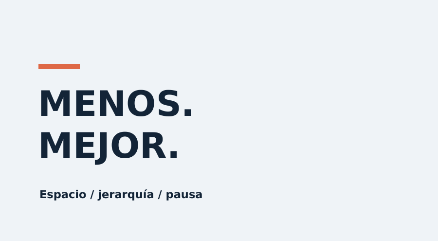

*Esquema de identificación; no es una muestra de acabado final.*

### Cómo reconocerlo

Espacio vacío, retícula clara, pocos colores y tipografía con jerarquía precisa.

### Receta de movimiento

Revelar título por máscara de 0,6 s; desplazar 16 px; sostener al menos 2 s. Un acento gráfico por plano.

### Cuándo aplicarlo

Entrevistas, ensayos, créditos y contenido profesional.

### Cómo implementarlo

Remotion/SVG con tipografía medible y márgenes constantes.

### Ejemplo concreto

Una cita breve entra junto a un retrato, con nombre y cargo.

### Evitar

Texto pequeño por parecer elegante; transiciones ornamentales; títulos sin contraste.

### Prompt para crear

Crea una escena sobre [TEMA] en estilo S21, Editorial minimalista. Usa esta dirección visual: Espacio vacío, retícula clara, pocos colores y tipografía con jerarquía precisa. Sustituye el contenido de muestra por [OBJETO] y el texto exacto [TEXTO]. Movimiento: Revelar título por máscara de 0,6 s; desplazar 16 px; sostener al menos 2 s. Un acento gráfico por plano. Organiza entrada, desarrollo y cierre para una duración inicial de 8 s. Implementación propuesta: Remotion/SVG con tipografía medible y márgenes constantes. Entrega un render y las fuentes editables si el entorno dispone del motor necesario. Conserva el texto como capa exacta.

### Prompt para editar

Edita [ARCHIVO], en [TRAMO], aplicando S21, Editorial minimalista. Objetivo: Entrevistas, ensayos, créditos y contenido profesional. Adapta este comportamiento al plano: Revelar título por máscara de 0,6 s; desplazar 16 px; sostener al menos 2 s. Un acento gráfico por plano. Conserva la voz, identidad, hechos y continuidad. Decide si corresponde overlay, tratamiento, transición o reconstrucción; explica cualquier recurso faltante. Mantén libres rostro, subtítulos e información esencial. Usa [TEXTO] solo donde ayude al mensaje. Revisa una muestra en movimiento y luego el archivo final.

### Comprobación

Comprobar estos rasgos: Espacio vacío, retícula clara, pocos colores y tipografía con jerarquía precisa. Verificar además lectura, estabilidad temporal, fidelidad del contenido y ausencia de estos defectos: Texto pequeño por parecer elegante; transiciones ornamentales; títulos sin contraste.

## S22 · Collage de papel

**Ampliación de la guía** · Material gráfico

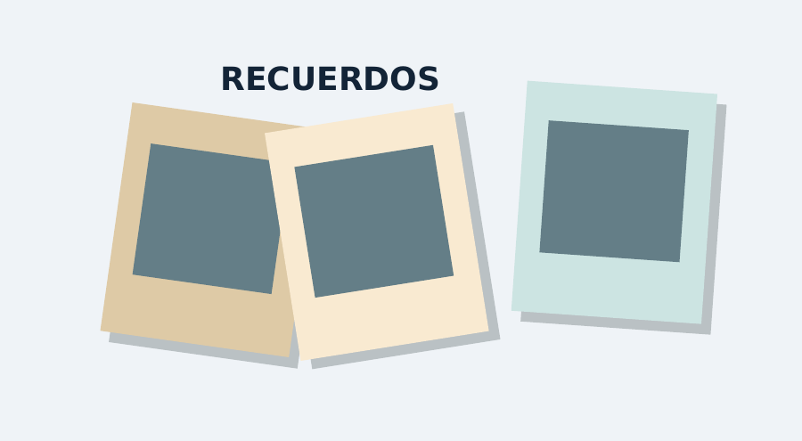

*Esquema de identificación; no es una muestra de acabado final.*

### Cómo reconocerlo

Recortes con bordes irregulares, papel, fotografías y capas con sombras pequeñas.

### Receta de movimiento

Colocar recortes uno por uno con movimientos escalonados; leve rotación y textura fija pegada al papel.

### Cuándo aplicarlo

Historias, recuerdos, viajes y explicaciones culturales.

### Cómo implementarlo

Recortes PNG autorizados más máscaras SVG; cámara 2D y sombras por capa.

### Ejemplo concreto

Tres fotografías y una fecha construyen una página de recuerdos.

### Evitar

Texturas que hierven; demasiados elementos; recortes sin relación con el relato.

### Prompt para crear

Crea una escena sobre [TEMA] en estilo S22, Collage de papel. Usa esta dirección visual: Recortes con bordes irregulares, papel, fotografías y capas con sombras pequeñas. Sustituye el contenido de muestra por [OBJETO] y el texto exacto [TEXTO]. Movimiento: Colocar recortes uno por uno con movimientos escalonados; leve rotación y textura fija pegada al papel. Organiza entrada, desarrollo y cierre para una duración inicial de 8 s. Implementación propuesta: Recortes PNG autorizados más máscaras SVG; cámara 2D y sombras por capa. Entrega un render y las fuentes editables si el entorno dispone del motor necesario. Conserva el texto como capa exacta.

### Prompt para editar

Edita [ARCHIVO], en [TRAMO], aplicando S22, Collage de papel. Objetivo: Historias, recuerdos, viajes y explicaciones culturales. Adapta este comportamiento al plano: Colocar recortes uno por uno con movimientos escalonados; leve rotación y textura fija pegada al papel. Conserva la voz, identidad, hechos y continuidad. Decide si corresponde overlay, tratamiento, transición o reconstrucción; explica cualquier recurso faltante. Mantén libres rostro, subtítulos e información esencial. Usa [TEXTO] solo donde ayude al mensaje. Revisa una muestra en movimiento y luego el archivo final.

### Comprobación

Comprobar estos rasgos: Recortes con bordes irregulares, papel, fotografías y capas con sombras pequeñas. Verificar además lectura, estabilidad temporal, fidelidad del contenido y ausencia de estos defectos: Texturas que hierven; demasiados elementos; recortes sin relación con el relato.

## S23 · Parallax 2.5D

**Ampliación de la guía** · Profundidad

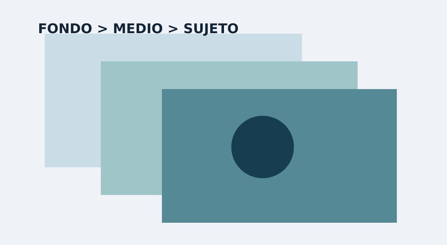

*Esquema de identificación; no es una muestra de acabado final.*

### Cómo reconocerlo

Fotografía separada en sujeto, plano medio y fondo con desplazamientos diferentes.

### Receta de movimiento

Acercar la cámara 5 %; mover primer plano 24 px y fondo 8 px. Rellenar zonas descubiertas antes de animar.

### Cuándo aplicarlo

Dar vida a fotografías, biografías y documentales.

### Cómo implementarlo

Máscaras por profundidad y composición 2D/3D; inpainting solo si está disponible y se revisa.

### Ejemplo concreto

Una foto de paisaje adquiere profundidad con un avance lento.

### Evitar

Huecos detrás del sujeto; deformar caras; parallax excesivo que revela el recorte.

### Prompt para crear

Crea una escena sobre [TEMA] en estilo S23, Parallax 2.5D. Usa esta dirección visual: Fotografía separada en sujeto, plano medio y fondo con desplazamientos diferentes. Sustituye el contenido de muestra por [OBJETO] y el texto exacto [TEXTO]. Movimiento: Acercar la cámara 5 %; mover primer plano 24 px y fondo 8 px. Rellenar zonas descubiertas antes de animar. Organiza entrada, desarrollo y cierre para una duración inicial de 8 s. Implementación propuesta: Máscaras por profundidad y composición 2D/3D; inpainting solo si está disponible y se revisa. Entrega un render y las fuentes editables si el entorno dispone del motor necesario. Conserva el texto como capa exacta.

### Prompt para editar

Edita [ARCHIVO], en [TRAMO], aplicando S23, Parallax 2.5D. Objetivo: Dar vida a fotografías, biografías y documentales. Adapta este comportamiento al plano: Acercar la cámara 5 %; mover primer plano 24 px y fondo 8 px. Rellenar zonas descubiertas antes de animar. Conserva la voz, identidad, hechos y continuidad. Decide si corresponde overlay, tratamiento, transición o reconstrucción; explica cualquier recurso faltante. Mantén libres rostro, subtítulos e información esencial. Usa [TEXTO] solo donde ayude al mensaje. Revisa una muestra en movimiento y luego el archivo final.

### Comprobación

Comprobar estos rasgos: Fotografía separada en sujeto, plano medio y fondo con desplazamientos diferentes. Verificar además lectura, estabilidad temporal, fidelidad del contenido y ausencia de estos defectos: Huecos detrás del sujeto; deformar caras; parallax excesivo que revela el recorte.

## S24 · Doodle / Anotación dibujada

**Ampliación de la guía** · Trazo

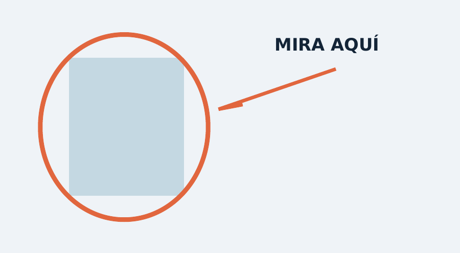

*Esquema de identificación; no es una muestra de acabado final.*

### Cómo reconocerlo

Flechas, círculos y notas de aspecto manual alrededor del contenido.

### Receta de movimiento

Dibujar cada trazo durante 0,4 s; fijarlo al objeto si se mueve; retirar antes de introducir la siguiente idea.

### Cuándo aplicarlo

Tutoriales, comentarios y explicaciones sobre video real.

### Cómo implementarlo

SVG con stroke-dashoffset y tracking cuando sea necesario; tipografía legible para las notas.

### Ejemplo concreto

Un círculo señala un detalle y una flecha conecta con una nota.

### Evitar

Tapar lo que se explica; vibración continua; flechas sin anclaje.

### Prompt para crear

Crea una escena sobre [TEMA] en estilo S24, Doodle / Anotación dibujada. Usa esta dirección visual: Flechas, círculos y notas de aspecto manual alrededor del contenido. Sustituye el contenido de muestra por [OBJETO] y el texto exacto [TEXTO]. Movimiento: Dibujar cada trazo durante 0,4 s; fijarlo al objeto si se mueve; retirar antes de introducir la siguiente idea. Organiza entrada, desarrollo y cierre para una duración inicial de 8 s. Implementación propuesta: SVG con stroke-dashoffset y tracking cuando sea necesario; tipografía legible para las notas. Entrega un render y las fuentes editables si el entorno dispone del motor necesario. Conserva el texto como capa exacta.

### Prompt para editar

Edita [ARCHIVO], en [TRAMO], aplicando S24, Doodle / Anotación dibujada. Objetivo: Tutoriales, comentarios y explicaciones sobre video real. Adapta este comportamiento al plano: Dibujar cada trazo durante 0,4 s; fijarlo al objeto si se mueve; retirar antes de introducir la siguiente idea. Conserva la voz, identidad, hechos y continuidad. Decide si corresponde overlay, tratamiento, transición o reconstrucción; explica cualquier recurso faltante. Mantén libres rostro, subtítulos e información esencial. Usa [TEXTO] solo donde ayude al mensaje. Revisa una muestra en movimiento y luego el archivo final.

### Comprobación

Comprobar estos rasgos: Flechas, círculos y notas de aspecto manual alrededor del contenido. Verificar además lectura, estabilidad temporal, fidelidad del contenido y ausencia de estos defectos: Tapar lo que se explica; vibración continua; flechas sin anclaje.

## S25 · Line art / Trazo continuo

**Ampliación de la guía** · Dibujo

*Esquema de identificación; no es una muestra de acabado final.*

### Cómo reconocerlo

Figuras de contorno limpio, pocos rellenos y una línea que organiza el plano.

### Receta de movimiento

Revelar trazos en orden semántico; mantener velocidad de punta coherente; terminar con una pausa.

### Cuándo aplicarlo

Explicadores, diagramas simples y títulos delicados.

### Cómo implementarlo

SVG con longitudes de path medidas y máscaras; ordenar trazos manualmente.

### Ejemplo concreto

Una línea dibuja una bombilla y conecta con una palabra.

### Evitar

Líneas que se dibujan desde extremos arbitrarios; contornos finísimos; ilustración demasiado compleja.

### Prompt para crear

Crea una escena sobre [TEMA] en estilo S25, Line art / Trazo continuo. Usa esta dirección visual: Figuras de contorno limpio, pocos rellenos y una línea que organiza el plano. Sustituye el contenido de muestra por [OBJETO] y el texto exacto [TEXTO]. Movimiento: Revelar trazos en orden semántico; mantener velocidad de punta coherente; terminar con una pausa. Organiza entrada, desarrollo y cierre para una duración inicial de 8 s. Implementación propuesta: SVG con longitudes de path medidas y máscaras; ordenar trazos manualmente. Entrega un render y las fuentes editables si el entorno dispone del motor necesario. Conserva el texto como capa exacta.

### Prompt para editar

Edita [ARCHIVO], en [TRAMO], aplicando S25, Line art / Trazo continuo. Objetivo: Explicadores, diagramas simples y títulos delicados. Adapta este comportamiento al plano: Revelar trazos en orden semántico; mantener velocidad de punta coherente; terminar con una pausa. Conserva la voz, identidad, hechos y continuidad. Decide si corresponde overlay, tratamiento, transición o reconstrucción; explica cualquier recurso faltante. Mantén libres rostro, subtítulos e información esencial. Usa [TEXTO] solo donde ayude al mensaje. Revisa una muestra en movimiento y luego el archivo final.

### Comprobación

Comprobar estos rasgos: Figuras de contorno limpio, pocos rellenos y una línea que organiza el plano. Verificar además lectura, estabilidad temporal, fidelidad del contenido y ausencia de estos defectos: Líneas que se dibujan desde extremos arbitrarios; contornos finísimos; ilustración demasiado compleja.

## S26 · Infografía animada

**Ampliación de la guía** · Información

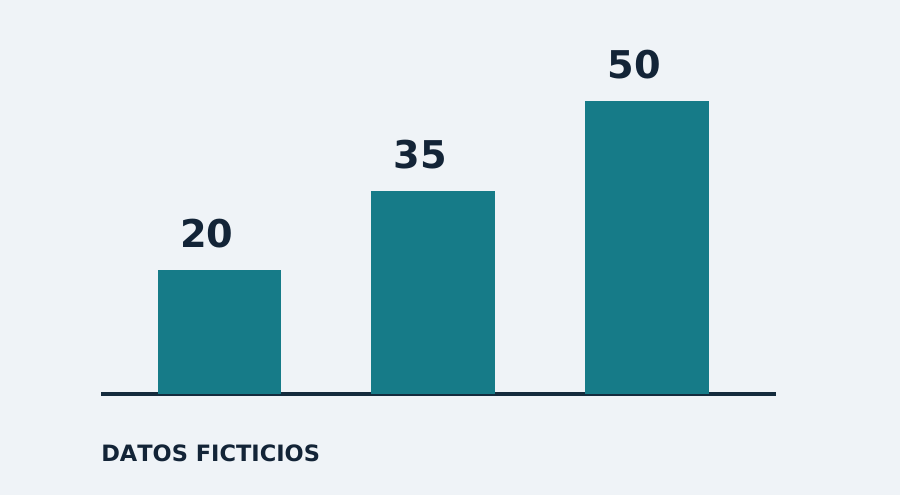

*Esquema de identificación; no es una muestra de acabado final.*

### Cómo reconocerlo

Gráficos, cifras, comparaciones y etiquetas subordinados a un mensaje verificable.

### Receta de movimiento

Revelar ejes, después valores, después la conclusión; sincronizar con la explicación. Mantener escalas constantes.

### Cuándo aplicarlo

Análisis, educación y resúmenes de resultados.

### Cómo implementarlo

SVG/Remotion; datos externos validados y formato numérico explícito.

### Ejemplo concreto

Tres barras comparan valores de ejemplo 20, 35 y 50, rotulados como ficticios.

### Evitar

Inventar estadísticas; ejes truncados engañosos; cifras que no coinciden con la voz.

### Prompt para crear

Crea una escena sobre [TEMA] en estilo S26, Infografía animada. Usa esta dirección visual: Gráficos, cifras, comparaciones y etiquetas subordinados a un mensaje verificable. Sustituye el contenido de muestra por [OBJETO] y el texto exacto [TEXTO]. Movimiento: Revelar ejes, después valores, después la conclusión; sincronizar con la explicación. Mantener escalas constantes. Organiza entrada, desarrollo y cierre para una duración inicial de 8 s. Implementación propuesta: SVG/Remotion; datos externos validados y formato numérico explícito. Entrega un render y las fuentes editables si el entorno dispone del motor necesario. Conserva el texto como capa exacta.

### Prompt para editar

Edita [ARCHIVO], en [TRAMO], aplicando S26, Infografía animada. Objetivo: Análisis, educación y resúmenes de resultados. Adapta este comportamiento al plano: Revelar ejes, después valores, después la conclusión; sincronizar con la explicación. Mantener escalas constantes. Conserva la voz, identidad, hechos y continuidad. Decide si corresponde overlay, tratamiento, transición o reconstrucción; explica cualquier recurso faltante. Mantén libres rostro, subtítulos e información esencial. Usa [TEXTO] solo donde ayude al mensaje. Revisa una muestra en movimiento y luego el archivo final.

### Comprobación

Comprobar estos rasgos: Gráficos, cifras, comparaciones y etiquetas subordinados a un mensaje verificable. Verificar además lectura, estabilidad temporal, fidelidad del contenido y ausencia de estos defectos: Inventar estadísticas; ejes truncados engañosos; cifras que no coinciden con la voz.

## S27 · HUD / Interfaz de ciencia ficción

**Ampliación de la guía** · Interfaz

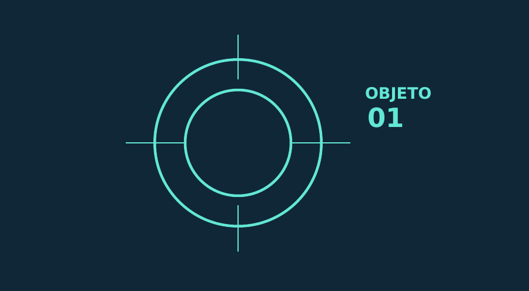

*Esquema de identificación; no es una muestra de acabado final.*

### Cómo reconocerlo

Retículas, anillos, etiquetas de seguimiento y pequeños indicadores funcionales.

### Receta de movimiento

Hacer un barrido corto, fijar un objetivo y revelar dos datos. El HUD sigue al elemento sin saltos.

### Cuándo aplicarlo

Explicaciones tecnológicas, juegos y análisis visual.

### Cómo implementarlo

SVG/Canvas con tracking o coordenadas del plano; Three.js si debe integrarse en perspectiva.

### Ejemplo concreto

Una retícula identifica una pieza y muestra dos atributos reales.

### Evitar

Texto decorativo ilegible; datos inventados sin señalarlos; cubrir toda la pantalla.

### Prompt para crear

Crea una escena sobre [TEMA] en estilo S27, HUD / Interfaz de ciencia ficción. Usa esta dirección visual: Retículas, anillos, etiquetas de seguimiento y pequeños indicadores funcionales. Sustituye el contenido de muestra por [OBJETO] y el texto exacto [TEXTO]. Movimiento: Hacer un barrido corto, fijar un objetivo y revelar dos datos. El HUD sigue al elemento sin saltos. Organiza entrada, desarrollo y cierre para una duración inicial de 8 s. Implementación propuesta: SVG/Canvas con tracking o coordenadas del plano; Three.js si debe integrarse en perspectiva. Entrega un render y las fuentes editables si el entorno dispone del motor necesario. Conserva el texto como capa exacta.

### Prompt para editar

Edita [ARCHIVO], en [TRAMO], aplicando S27, HUD / Interfaz de ciencia ficción. Objetivo: Explicaciones tecnológicas, juegos y análisis visual. Adapta este comportamiento al plano: Hacer un barrido corto, fijar un objetivo y revelar dos datos. El HUD sigue al elemento sin saltos. Conserva la voz, identidad, hechos y continuidad. Decide si corresponde overlay, tratamiento, transición o reconstrucción; explica cualquier recurso faltante. Mantén libres rostro, subtítulos e información esencial. Usa [TEXTO] solo donde ayude al mensaje. Revisa una muestra en movimiento y luego el archivo final.

### Comprobación

Comprobar estos rasgos: Retículas, anillos, etiquetas de seguimiento y pequeños indicadores funcionales. Verificar además lectura, estabilidad temporal, fidelidad del contenido y ausencia de estos defectos: Texto decorativo ilegible; datos inventados sin señalarlos; cubrir toda la pantalla.

## S28 · Glitch digital

**Ampliación de la guía** · Transición

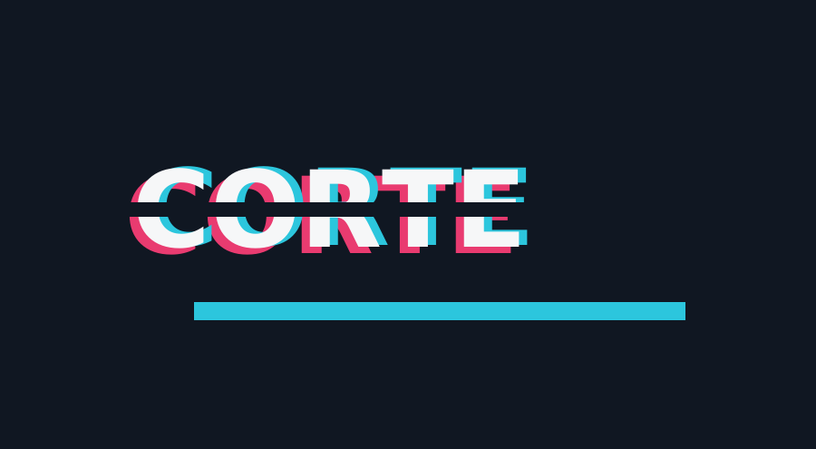

*Esquema de identificación; no es una muestra de acabado final.*

### Cómo reconocerlo

Desalineación RGB, bloques y saltos digitales breves con recuperación inmediata.

### Receta de movimiento

Concentrar el fallo en 3 a 6 fotogramas a 30 fps; regresar a imagen limpia y sostener el mensaje.

### Cuándo aplicarlo

Cambio de tema, interrupción narrativa y acento tecnológico.

### Cómo implementarlo

Compositor con desplazamiento por bandas y separación de canales; patrón determinista.

### Ejemplo concreto

Un corte con glitch separa una pregunta de su respuesta.

### Evitar

Destellos persistentes; ruido durante toda la voz; ocultar la información importante.

### Prompt para crear

Crea una escena sobre [TEMA] en estilo S28, Glitch digital. Usa esta dirección visual: Desalineación RGB, bloques y saltos digitales breves con recuperación inmediata. Sustituye el contenido de muestra por [OBJETO] y el texto exacto [TEXTO]. Movimiento: Concentrar el fallo en 3 a 6 fotogramas a 30 fps; regresar a imagen limpia y sostener el mensaje. Organiza entrada, desarrollo y cierre para una duración inicial de 8 s. Implementación propuesta: Compositor con desplazamiento por bandas y separación de canales; patrón determinista. Entrega un render y las fuentes editables si el entorno dispone del motor necesario. Conserva el texto como capa exacta.

### Prompt para editar

Edita [ARCHIVO], en [TRAMO], aplicando S28, Glitch digital. Objetivo: Cambio de tema, interrupción narrativa y acento tecnológico. Adapta este comportamiento al plano: Concentrar el fallo en 3 a 6 fotogramas a 30 fps; regresar a imagen limpia y sostener el mensaje. Conserva la voz, identidad, hechos y continuidad. Decide si corresponde overlay, tratamiento, transición o reconstrucción; explica cualquier recurso faltante. Mantén libres rostro, subtítulos e información esencial. Usa [TEXTO] solo donde ayude al mensaje. Revisa una muestra en movimiento y luego el archivo final.

### Comprobación

Comprobar estos rasgos: Desalineación RGB, bloques y saltos digitales breves con recuperación inmediata. Verificar además lectura, estabilidad temporal, fidelidad del contenido y ausencia de estos defectos: Destellos persistentes; ruido durante toda la voz; ocultar la información importante.

## S29 · Synthwave / Retrofuturismo

**Ampliación de la guía** · Dirección artística

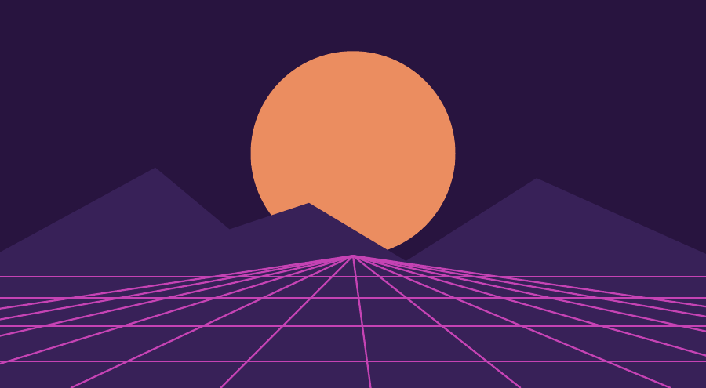

*Esquema de identificación; no es una muestra de acabado final.*

### Cómo reconocerlo

Sol segmentado, horizonte oscuro, rejilla de perspectiva y paleta violeta-magenta.

### Receta de movimiento

Desplazar rejilla hacia cámara; mantener horizonte estable y hacer respirar el sol muy lentamente.

### Cuándo aplicarlo

Música electrónica, nostalgia futurista y fondos de capítulos.

### Cómo implementarlo

Three.js o SVG con proyección y gradientes; VHS opcional como tratamiento separado.

### Ejemplo concreto

Un título limpio emerge sobre una carretera geométrica nocturna.

### Evitar

Añadir VHS por obligación; horizonte que tiembla; paleta sin contraste.

### Prompt para crear

Crea una escena sobre [TEMA] en estilo S29, Synthwave / Retrofuturismo. Usa esta dirección visual: Sol segmentado, horizonte oscuro, rejilla de perspectiva y paleta violeta-magenta. Sustituye el contenido de muestra por [OBJETO] y el texto exacto [TEXTO]. Movimiento: Desplazar rejilla hacia cámara; mantener horizonte estable y hacer respirar el sol muy lentamente. Organiza entrada, desarrollo y cierre para una duración inicial de 8 s. Implementación propuesta: Three.js o SVG con proyección y gradientes; VHS opcional como tratamiento separado. Entrega un render y las fuentes editables si el entorno dispone del motor necesario. Conserva el texto como capa exacta.

### Prompt para editar

Edita [ARCHIVO], en [TRAMO], aplicando S29, Synthwave / Retrofuturismo. Objetivo: Música electrónica, nostalgia futurista y fondos de capítulos. Adapta este comportamiento al plano: Desplazar rejilla hacia cámara; mantener horizonte estable y hacer respirar el sol muy lentamente. Conserva la voz, identidad, hechos y continuidad. Decide si corresponde overlay, tratamiento, transición o reconstrucción; explica cualquier recurso faltante. Mantén libres rostro, subtítulos e información esencial. Usa [TEXTO] solo donde ayude al mensaje. Revisa una muestra en movimiento y luego el archivo final.

### Comprobación

Comprobar estos rasgos: Sol segmentado, horizonte oscuro, rejilla de perspectiva y paleta violeta-magenta. Verificar además lectura, estabilidad temporal, fidelidad del contenido y ausencia de estos defectos: Añadir VHS por obligación; horizonte que tiembla; paleta sin contraste.

## S30 · Película analógica

**Ampliación de la guía** · Tratamiento de imagen

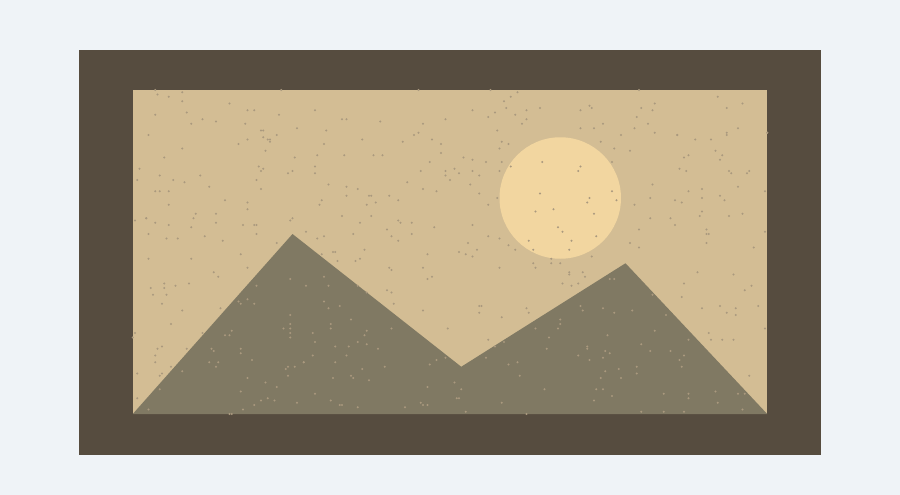

*Esquema de identificación; no es una muestra de acabado final.*

### Cómo reconocerlo

Grano fino, contraste suave, calidez moderada y respuesta orgánica de altas luces.

### Receta de movimiento

Aplicar textura temporal sutil; corrección de exposición por plano; gate weave mínimo solo cuando sea intencional.

### Cuándo aplicarlo

Historias íntimas, viajes y piezas documentales.

### Cómo implementarlo

Compositor o color grading con curva y grano; gestionar color según el material de origen.

### Ejemplo concreto

Una secuencia cotidiana adquiere un acabado cálido y discreto.

### Evitar

Quemar blancos; aplicar una LUT sin corregir exposición; pieles naranjas; suciedad permanente.

### Prompt para crear

Crea una escena sobre [TEMA] en estilo S30, Película analógica. Usa esta dirección visual: Grano fino, contraste suave, calidez moderada y respuesta orgánica de altas luces. Sustituye el contenido de muestra por [OBJETO] y el texto exacto [TEXTO]. Movimiento: Aplicar textura temporal sutil; corrección de exposición por plano; gate weave mínimo solo cuando sea intencional. Organiza entrada, desarrollo y cierre para una duración inicial de 8 s. Implementación propuesta: Compositor o color grading con curva y grano; gestionar color según el material de origen. Entrega un render y las fuentes editables si el entorno dispone del motor necesario. Conserva el texto como capa exacta.

### Prompt para editar

Edita [ARCHIVO], en [TRAMO], aplicando S30, Película analógica. Objetivo: Historias íntimas, viajes y piezas documentales. Adapta este comportamiento al plano: Aplicar textura temporal sutil; corrección de exposición por plano; gate weave mínimo solo cuando sea intencional. Conserva la voz, identidad, hechos y continuidad. Decide si corresponde overlay, tratamiento, transición o reconstrucción; explica cualquier recurso faltante. Mantén libres rostro, subtítulos e información esencial. Usa [TEXTO] solo donde ayude al mensaje. Revisa una muestra en movimiento y luego el archivo final.

### Comprobación

Comprobar estos rasgos: Grano fino, contraste suave, calidez moderada y respuesta orgánica de altas luces. Verificar además lectura, estabilidad temporal, fidelidad del contenido y ausencia de estos defectos: Quemar blancos; aplicar una LUT sin corregir exposición; pieles naranjas; suciedad permanente.

## S31 · Stop motion / Animación por poses

**Ampliación de la guía** · Temporalidad

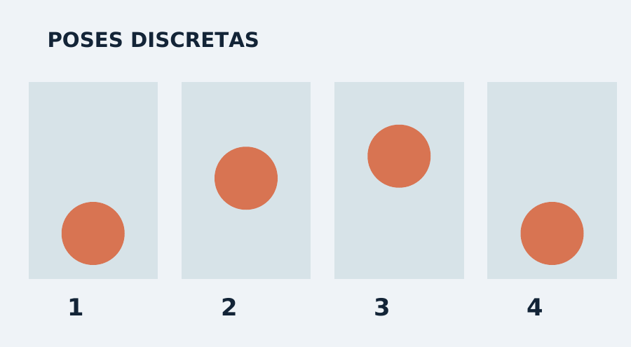

*Esquema de identificación; no es una muestra de acabado final.*

### Cómo reconocerlo

Movimiento deliberadamente escalonado y pequeñas diferencias de colocación entre poses.

### Receta de movimiento

Diseñar a 12 poses por segundo y muestrearlas en salida a 24 fps; cada pose dura 2 fotogramas. Añadir asentamiento leve.

### Cuándo aplicarlo

Objetos, manualidades, comida y relatos juguetones.

### Cómo implementarlo

Blender con interpolación constante o compositor con retención de fotogramas y recortes.

### Ejemplo concreto

Cinco objetos se ordenan solos formando una palabra.

### Evitar

Aplicarlo a toda una entrevista; saltos arbitrarios; confundir baja calidad con animación por poses.

### Prompt para crear

Crea una escena sobre [TEMA] en estilo S31, Stop motion / Animación por poses. Usa esta dirección visual: Movimiento deliberadamente escalonado y pequeñas diferencias de colocación entre poses. Sustituye el contenido de muestra por [OBJETO] y el texto exacto [TEXTO]. Movimiento: Diseñar a 12 poses por segundo y muestrearlas en salida a 24 fps; cada pose dura 2 fotogramas. Añadir asentamiento leve. Organiza entrada, desarrollo y cierre para una duración inicial de 8 s. Implementación propuesta: Blender con interpolación constante o compositor con retención de fotogramas y recortes. Entrega un render y las fuentes editables si el entorno dispone del motor necesario. Conserva el texto como capa exacta.

### Prompt para editar

Edita [ARCHIVO], en [TRAMO], aplicando S31, Stop motion / Animación por poses. Objetivo: Objetos, manualidades, comida y relatos juguetones. Adapta este comportamiento al plano: Diseñar a 12 poses por segundo y muestrearlas en salida a 24 fps; cada pose dura 2 fotogramas. Añadir asentamiento leve. Conserva la voz, identidad, hechos y continuidad. Decide si corresponde overlay, tratamiento, transición o reconstrucción; explica cualquier recurso faltante. Mantén libres rostro, subtítulos e información esencial. Usa [TEXTO] solo donde ayude al mensaje. Revisa una muestra en movimiento y luego el archivo final.

### Comprobación

Comprobar estos rasgos: Movimiento deliberadamente escalonado y pequeñas diferencias de colocación entre poses. Verificar además lectura, estabilidad temporal, fidelidad del contenido y ausencia de estos defectos: Aplicarlo a toda una entrevista; saltos arbitrarios; confundir baja calidad con animación por poses.

## S32 · Cel shading / Cartoon 3D

**Ampliación de la guía** · Material

*Esquema de identificación; no es una muestra de acabado final.*

### Cómo reconocerlo

Objetos 3D con dos o tres bandas de luz y contornos definidos.

### Receta de movimiento

Animar siluetas claras; exageración moderada de anticipación y frenado; conservar bandas de sombra estables.

### Cuándo aplicarlo

Explicadores, personajes y productos de estética ilustrada.

### Cómo implementarlo

Blender/Three.js con material toon y contorno; controlar normales y grosor según distancia.

### Ejemplo concreto

Un objeto gira mostrando su forma con tres tonos y borde oscuro.

### Evitar

Sombras que parpadean; contorno desigual; depender solo de un filtro sobre imagen real.

### Prompt para crear

Crea una escena sobre [TEMA] en estilo S32, Cel shading / Cartoon 3D. Usa esta dirección visual: Objetos 3D con dos o tres bandas de luz y contornos definidos. Sustituye el contenido de muestra por [OBJETO] y el texto exacto [TEXTO]. Movimiento: Animar siluetas claras; exageración moderada de anticipación y frenado; conservar bandas de sombra estables. Organiza entrada, desarrollo y cierre para una duración inicial de 8 s. Implementación propuesta: Blender/Three.js con material toon y contorno; controlar normales y grosor según distancia. Entrega un render y las fuentes editables si el entorno dispone del motor necesario. Conserva el texto como capa exacta.

### Prompt para editar

Edita [ARCHIVO], en [TRAMO], aplicando S32, Cel shading / Cartoon 3D. Objetivo: Explicadores, personajes y productos de estética ilustrada. Adapta este comportamiento al plano: Animar siluetas claras; exageración moderada de anticipación y frenado; conservar bandas de sombra estables. Conserva la voz, identidad, hechos y continuidad. Decide si corresponde overlay, tratamiento, transición o reconstrucción; explica cualquier recurso faltante. Mantén libres rostro, subtítulos e información esencial. Usa [TEXTO] solo donde ayude al mensaje. Revisa una muestra en movimiento y luego el archivo final.

### Comprobación

Comprobar estos rasgos: Objetos 3D con dos o tres bandas de luz y contornos definidos. Verificar además lectura, estabilidad temporal, fidelidad del contenido y ausencia de estos defectos: Sombras que parpadean; contorno desigual; depender solo de un filtro sobre imagen real.

## S33 · Low poly

**Ampliación de la guía** · Geometría

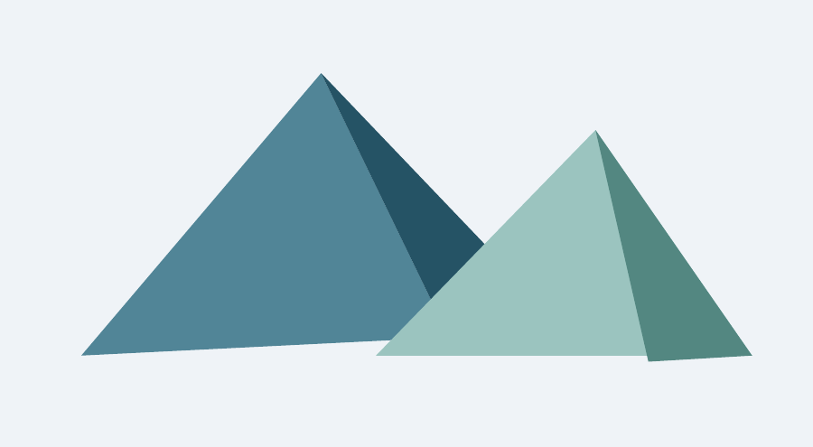

*Esquema de identificación; no es una muestra de acabado final.*

### Cómo reconocerlo

Formas tridimensionales de pocas caras visibles, con siluetas sencillas.

### Receta de movimiento

Orbitar la cámara lentamente y escalonar la aparición de piezas; iluminación que muestre las facetas.

### Cuándo aplicarlo

Mapas, paisajes estilizados y explicaciones espaciales.

### Cómo implementarlo

Blender/Three.js con malla reducida y flat shading.

### Ejemplo concreto

Un paisaje de montañas facetadas se construye por capas.

### Evitar

Eliminar polígonos hasta perder la silueta; reflejos fotorealistas incoherentes; confundirlo con vóxeles.

### Prompt para crear

Crea una escena sobre [TEMA] en estilo S33, Low poly. Usa esta dirección visual: Formas tridimensionales de pocas caras visibles, con siluetas sencillas. Sustituye el contenido de muestra por [OBJETO] y el texto exacto [TEXTO]. Movimiento: Orbitar la cámara lentamente y escalonar la aparición de piezas; iluminación que muestre las facetas. Organiza entrada, desarrollo y cierre para una duración inicial de 8 s. Implementación propuesta: Blender/Three.js con malla reducida y flat shading. Entrega un render y las fuentes editables si el entorno dispone del motor necesario. Conserva el texto como capa exacta.

### Prompt para editar

Edita [ARCHIVO], en [TRAMO], aplicando S33, Low poly. Objetivo: Mapas, paisajes estilizados y explicaciones espaciales. Adapta este comportamiento al plano: Orbitar la cámara lentamente y escalonar la aparición de piezas; iluminación que muestre las facetas. Conserva la voz, identidad, hechos y continuidad. Decide si corresponde overlay, tratamiento, transición o reconstrucción; explica cualquier recurso faltante. Mantén libres rostro, subtítulos e información esencial. Usa [TEXTO] solo donde ayude al mensaje. Revisa una muestra en movimiento y luego el archivo final.

### Comprobación

Comprobar estos rasgos: Formas tridimensionales de pocas caras visibles, con siluetas sencillas. Verificar además lectura, estabilidad temporal, fidelidad del contenido y ausencia de estos defectos: Eliminar polígonos hasta perder la silueta; reflejos fotorealistas incoherentes; confundirlo con vóxeles.

## S34 · Vóxel / Voxel

**Ampliación de la guía** · Geometría volumétrica

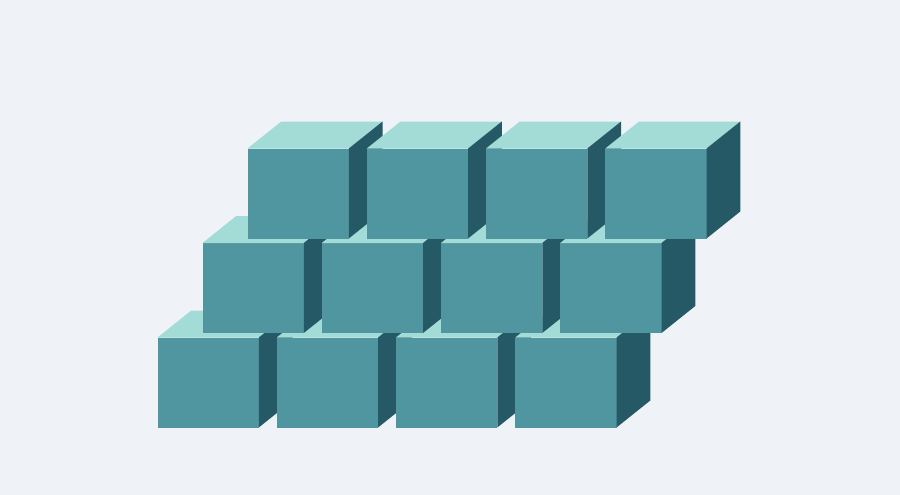

*Esquema de identificación; no es una muestra de acabado final.*

### Cómo reconocerlo

Objetos formados por bloques tridimensionales de tamaño consistente.

### Receta de movimiento

Ensamblar bloques por capas desde abajo; usar posiciones alineadas a la rejilla y oclusión coherente.

### Cuándo aplicarlo

Construcción modular, mundos de juego y representaciones volumétricas.

### Cómo implementarlo

Three.js con instancias o Blender; mantener una unidad de bloque común.

### Ejemplo concreto

Una cámara se ensambla a partir de pequeños cubos de colores.

### Evitar

Bloques de escala inconsistente; pixel art plano presentado como vóxel; geometría invisible excesiva.

### Prompt para crear

Crea una escena sobre [TEMA] en estilo S34, Vóxel / Voxel. Usa esta dirección visual: Objetos formados por bloques tridimensionales de tamaño consistente. Sustituye el contenido de muestra por [OBJETO] y el texto exacto [TEXTO]. Movimiento: Ensamblar bloques por capas desde abajo; usar posiciones alineadas a la rejilla y oclusión coherente. Organiza entrada, desarrollo y cierre para una duración inicial de 8 s. Implementación propuesta: Three.js con instancias o Blender; mantener una unidad de bloque común. Entrega un render y las fuentes editables si el entorno dispone del motor necesario. Conserva el texto como capa exacta.

### Prompt para editar

Edita [ARCHIVO], en [TRAMO], aplicando S34, Vóxel / Voxel. Objetivo: Construcción modular, mundos de juego y representaciones volumétricas. Adapta este comportamiento al plano: Ensamblar bloques por capas desde abajo; usar posiciones alineadas a la rejilla y oclusión coherente. Conserva la voz, identidad, hechos y continuidad. Decide si corresponde overlay, tratamiento, transición o reconstrucción; explica cualquier recurso faltante. Mantén libres rostro, subtítulos e información esencial. Usa [TEXTO] solo donde ayude al mensaje. Revisa una muestra en movimiento y luego el archivo final.

### Comprobación

Comprobar estos rasgos: Objetos formados por bloques tridimensionales de tamaño consistente. Verificar además lectura, estabilidad temporal, fidelidad del contenido y ausencia de estos defectos: Bloques de escala inconsistente; pixel art plano presentado como vóxel; geometría invisible excesiva.

## S35 · Tinta y acuarela

**Ampliación de la guía** · Material pictórico

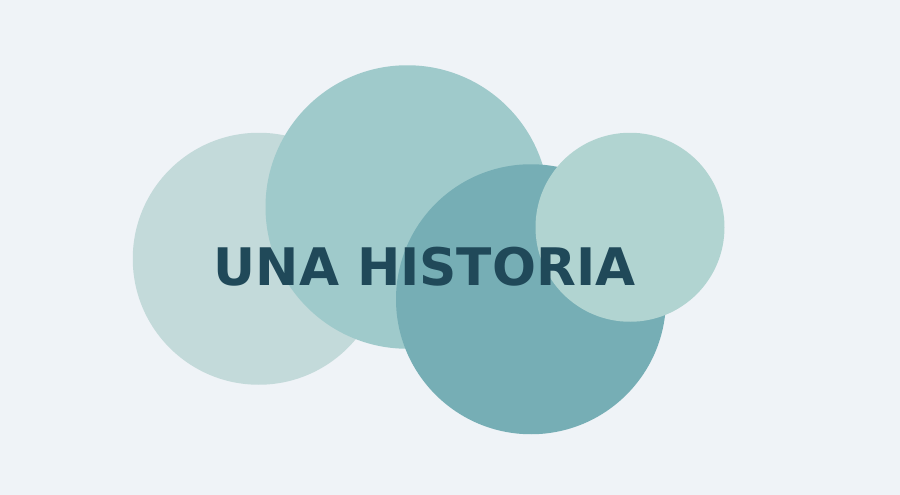

*Esquema de identificación; no es una muestra de acabado final.*

### Cómo reconocerlo

Pigmento que se expande sobre papel con bordes húmedos y densidad variable.

### Receta de movimiento

Revelar una mancha con máscara progresiva; fijar textura al papel; permitir difusión suave en el borde.

### Cuándo aplicarlo

Poesía, relatos emocionales y aperturas artísticas.

### Cómo implementarlo

Máscaras y texturas autorizadas, shader o material generado externo; componer texto por separado.

### Ejemplo concreto

Una mancha revela un paisaje y deja espacio limpio para el título.

### Evitar

Texto que se disuelve; textura que cambia sin control; fingir una simulación física completa.

### Prompt para crear

Crea una escena sobre [TEMA] en estilo S35, Tinta y acuarela. Usa esta dirección visual: Pigmento que se expande sobre papel con bordes húmedos y densidad variable. Sustituye el contenido de muestra por [OBJETO] y el texto exacto [TEXTO]. Movimiento: Revelar una mancha con máscara progresiva; fijar textura al papel; permitir difusión suave en el borde. Organiza entrada, desarrollo y cierre para una duración inicial de 8 s. Implementación propuesta: Máscaras y texturas autorizadas, shader o material generado externo; componer texto por separado. Entrega un render y las fuentes editables si el entorno dispone del motor necesario. Conserva el texto como capa exacta.

### Prompt para editar

Edita [ARCHIVO], en [TRAMO], aplicando S35, Tinta y acuarela. Objetivo: Poesía, relatos emocionales y aperturas artísticas. Adapta este comportamiento al plano: Revelar una mancha con máscara progresiva; fijar textura al papel; permitir difusión suave en el borde. Conserva la voz, identidad, hechos y continuidad. Decide si corresponde overlay, tratamiento, transición o reconstrucción; explica cualquier recurso faltante. Mantén libres rostro, subtítulos e información esencial. Usa [TEXTO] solo donde ayude al mensaje. Revisa una muestra en movimiento y luego el archivo final.

### Comprobación

Comprobar estos rasgos: Pigmento que se expande sobre papel con bordes húmedos y densidad variable. Verificar además lectura, estabilidad temporal, fidelidad del contenido y ausencia de estos defectos: Texto que se disuelve; textura que cambia sin control; fingir una simulación física completa.

## S36 · Producto de estudio / Macro 3D

**Ampliación de la guía** · Iluminación y cámara

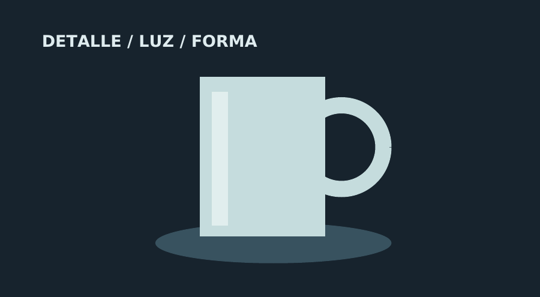

*Esquema de identificación; no es una muestra de acabado final.*

### Cómo reconocerlo

Objeto protagonista, fondo controlado, reflejos limpios y planos cercanos de detalles.

### Receta de movimiento

Alternar detalle, silueta y plano general; dolly lento; luz rasante para revelar bordes. Reservar el cierre para el nombre.

### Cuándo aplicarlo

Demostraciones de producto y presentaciones cuidadas.

### Cómo implementarlo

Blender con modelo fiel o footage real; composición tipográfica aparte.

### Ejemplo concreto

Una taza gira y revela su textura antes de mostrar la vista completa.

### Evitar

Inventar piezas o logotipos; superficies deformadas; profundidad de campo que oculta lo importante.

### Prompt para crear

Crea una escena sobre [TEMA] en estilo S36, Producto de estudio / Macro 3D. Usa esta dirección visual: Objeto protagonista, fondo controlado, reflejos limpios y planos cercanos de detalles. Sustituye el contenido de muestra por [OBJETO] y el texto exacto [TEXTO]. Movimiento: Alternar detalle, silueta y plano general; dolly lento; luz rasante para revelar bordes. Reservar el cierre para el nombre. Organiza entrada, desarrollo y cierre para una duración inicial de 8 s. Implementación propuesta: Blender con modelo fiel o footage real; composición tipográfica aparte. Entrega un render y las fuentes editables si el entorno dispone del motor necesario. Conserva el texto como capa exacta.

### Prompt para editar

Edita [ARCHIVO], en [TRAMO], aplicando S36, Producto de estudio / Macro 3D. Objetivo: Demostraciones de producto y presentaciones cuidadas. Adapta este comportamiento al plano: Alternar detalle, silueta y plano general; dolly lento; luz rasante para revelar bordes. Reservar el cierre para el nombre. Conserva la voz, identidad, hechos y continuidad. Decide si corresponde overlay, tratamiento, transición o reconstrucción; explica cualquier recurso faltante. Mantén libres rostro, subtítulos e información esencial. Usa [TEXTO] solo donde ayude al mensaje. Revisa una muestra en movimiento y luego el archivo final.

### Comprobación

Comprobar estos rasgos: Objeto protagonista, fondo controlado, reflejos limpios y planos cercanos de detalles. Verificar además lectura, estabilidad temporal, fidelidad del contenido y ausencia de estos defectos: Inventar piezas o logotipos; superficies deformadas; profundidad de campo que oculta lo importante.

## S37 · Siluetas y contraluz

**Ampliación de la guía** · Iluminación

*Esquema de identificación; no es una muestra de acabado final.*

### Cómo reconocerlo

Figuras oscuras bien reconocibles frente a un fondo iluminado.

### Receta de movimiento

Mover la figura lateralmente y hacer un avance suave de cámara; preservar separación entre formas.

### Cuándo aplicarlo

Suspenso, poesía y aperturas con revelación.

### Cómo implementarlo

Grabación con contraluz, máscaras o Blender; comprobar bordes y negros.

### Ejemplo concreto

Una persona cruza un fondo luminoso antes del título.

### Evitar

Silueta irreconocible; empastar todas las figuras; usar contraste como sustituto de composición.

### Prompt para crear

Crea una escena sobre [TEMA] en estilo S37, Siluetas y contraluz. Usa esta dirección visual: Figuras oscuras bien reconocibles frente a un fondo iluminado. Sustituye el contenido de muestra por [OBJETO] y el texto exacto [TEXTO]. Movimiento: Mover la figura lateralmente y hacer un avance suave de cámara; preservar separación entre formas. Organiza entrada, desarrollo y cierre para una duración inicial de 8 s. Implementación propuesta: Grabación con contraluz, máscaras o Blender; comprobar bordes y negros. Entrega un render y las fuentes editables si el entorno dispone del motor necesario. Conserva el texto como capa exacta.

### Prompt para editar

Edita [ARCHIVO], en [TRAMO], aplicando S37, Siluetas y contraluz. Objetivo: Suspenso, poesía y aperturas con revelación. Adapta este comportamiento al plano: Mover la figura lateralmente y hacer un avance suave de cámara; preservar separación entre formas. Conserva la voz, identidad, hechos y continuidad. Decide si corresponde overlay, tratamiento, transición o reconstrucción; explica cualquier recurso faltante. Mantén libres rostro, subtítulos e información esencial. Usa [TEXTO] solo donde ayude al mensaje. Revisa una muestra en movimiento y luego el archivo final.

### Comprobación

Comprobar estos rasgos: Figuras oscuras bien reconocibles frente a un fondo iluminado. Verificar además lectura, estabilidad temporal, fidelidad del contenido y ausencia de estos defectos: Silueta irreconocible; empastar todas las figuras; usar contraste como sustituto de composición.

## S38 · Doble exposición

**Ampliación de la guía** · Composición de capas

*Esquema de identificación; no es una muestra de acabado final.*

### Cómo reconocerlo

Paisaje o textura contenido dentro de la silueta de un retrato.

### Receta de movimiento

Mantener silueta estable y mover el paisaje interior lentamente; revelar ojos o contorno al cierre.

### Cuándo aplicarlo

Memoria, identidad y piezas emocionales.

### Cómo implementarlo

Máscara del sujeto más matte de luminancia y modos de mezcla revisados; tracking si el retrato se mueve.

### Ejemplo concreto

Un paisaje de montañas aparece dentro de un retrato autorizado.

### Evitar

Bordes que tiemblan; rostro irreconocible; mezcla que parece transparencia accidental.

### Prompt para crear

Crea una escena sobre [TEMA] en estilo S38, Doble exposición. Usa esta dirección visual: Paisaje o textura contenido dentro de la silueta de un retrato. Sustituye el contenido de muestra por [OBJETO] y el texto exacto [TEXTO]. Movimiento: Mantener silueta estable y mover el paisaje interior lentamente; revelar ojos o contorno al cierre. Organiza entrada, desarrollo y cierre para una duración inicial de 8 s. Implementación propuesta: Máscara del sujeto más matte de luminancia y modos de mezcla revisados; tracking si el retrato se mueve. Entrega un render y las fuentes editables si el entorno dispone del motor necesario. Conserva el texto como capa exacta.

### Prompt para editar

Edita [ARCHIVO], en [TRAMO], aplicando S38, Doble exposición. Objetivo: Memoria, identidad y piezas emocionales. Adapta este comportamiento al plano: Mantener silueta estable y mover el paisaje interior lentamente; revelar ojos o contorno al cierre. Conserva la voz, identidad, hechos y continuidad. Decide si corresponde overlay, tratamiento, transición o reconstrucción; explica cualquier recurso faltante. Mantén libres rostro, subtítulos e información esencial. Usa [TEXTO] solo donde ayude al mensaje. Revisa una muestra en movimiento y luego el archivo final.

### Comprobación

Comprobar estos rasgos: Paisaje o textura contenido dentro de la silueta de un retrato. Verificar además lectura, estabilidad temporal, fidelidad del contenido y ausencia de estos defectos: Bordes que tiemblan; rostro irreconocible; mezcla que parece transparencia accidental.

## S39 · Datamosh simulado

**Ampliación de la guía** · Transición de distorsión

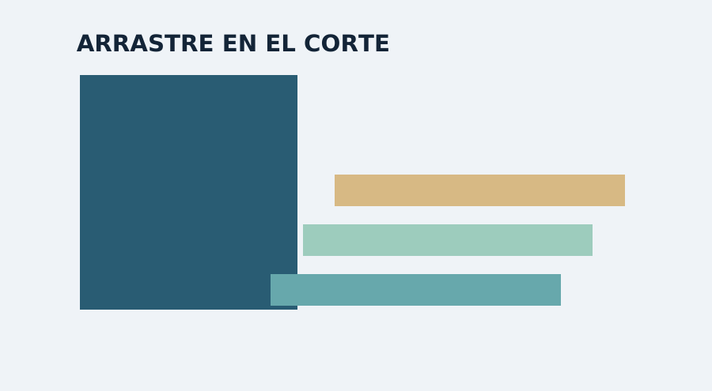

*Esquema de identificación; no es una muestra de acabado final.*

### Cómo reconocerlo

Bloques de imagen que parecen arrastrar información del plano anterior.

### Receta de movimiento

Arrastrar regiones durante 0,2 a 0,5 s alrededor del corte; restaurar de inmediato la nueva imagen.

### Cuándo aplicarlo

Piezas musicales y cortes experimentales breves.

### Cómo implementarlo

Compositor/shader con mapas de desplazamiento y bloques. Simular el efecto sin dañar el archivo de salida.

### Ejemplo concreto

Un movimiento rápido arrastra el color hacia el plano siguiente.

### Evitar

Corromper el códec final; transición larga e ilegible; confundirlo con separación RGB.

### Prompt para crear

Crea una escena sobre [TEMA] en estilo S39, Datamosh simulado. Usa esta dirección visual: Bloques de imagen que parecen arrastrar información del plano anterior. Sustituye el contenido de muestra por [OBJETO] y el texto exacto [TEXTO]. Movimiento: Arrastrar regiones durante 0,2 a 0,5 s alrededor del corte; restaurar de inmediato la nueva imagen. Organiza entrada, desarrollo y cierre para una duración inicial de 8 s. Implementación propuesta: Compositor/shader con mapas de desplazamiento y bloques. Simular el efecto sin dañar el archivo de salida. Entrega un render y las fuentes editables si el entorno dispone del motor necesario. Conserva el texto como capa exacta.

### Prompt para editar

Edita [ARCHIVO], en [TRAMO], aplicando S39, Datamosh simulado. Objetivo: Piezas musicales y cortes experimentales breves. Adapta este comportamiento al plano: Arrastrar regiones durante 0,2 a 0,5 s alrededor del corte; restaurar de inmediato la nueva imagen. Conserva la voz, identidad, hechos y continuidad. Decide si corresponde overlay, tratamiento, transición o reconstrucción; explica cualquier recurso faltante. Mantén libres rostro, subtítulos e información esencial. Usa [TEXTO] solo donde ayude al mensaje. Revisa una muestra en movimiento y luego el archivo final.

### Comprobación

Comprobar estos rasgos: Bloques de imagen que parecen arrastrar información del plano anterior. Verificar además lectura, estabilidad temporal, fidelidad del contenido y ausencia de estos defectos: Corromper el códec final; transición larga e ilegible; confundirlo con separación RGB.

## S40 · Pizarra / Chalkboard

**Ampliación de la guía** · Material y explicación

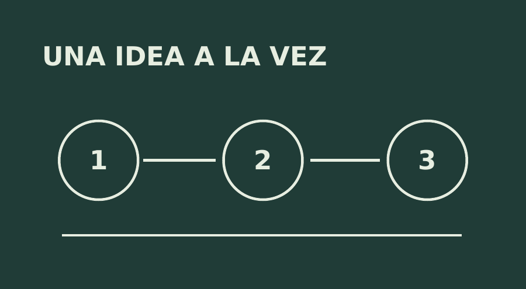

*Esquema de identificación; no es una muestra de acabado final.*

### Cómo reconocerlo

Fondo oscuro mate, trazos de tiza y anotaciones con estructura de lección.

### Receta de movimiento

Dibujar una idea por vez, subrayar la conclusión y borrar solo el área que se sustituye.

### Cuándo aplicarlo

Clases, problemas, esquemas y explicaciones pausadas.

### Cómo implementarlo

SVG/Canvas con textura sutil dentro del trazo; fórmulas y texto como elementos exactos.

### Ejemplo concreto

Un esquema de tres pasos aparece como una explicación en pizarra.

### Evitar

Letra ilegible; demasiada suciedad; mano dibujada que no sigue el trazo.

### Prompt para crear

Crea una escena sobre [TEMA] en estilo S40, Pizarra / Chalkboard. Usa esta dirección visual: Fondo oscuro mate, trazos de tiza y anotaciones con estructura de lección. Sustituye el contenido de muestra por [OBJETO] y el texto exacto [TEXTO]. Movimiento: Dibujar una idea por vez, subrayar la conclusión y borrar solo el área que se sustituye. Organiza entrada, desarrollo y cierre para una duración inicial de 8 s. Implementación propuesta: SVG/Canvas con textura sutil dentro del trazo; fórmulas y texto como elementos exactos. Entrega un render y las fuentes editables si el entorno dispone del motor necesario. Conserva el texto como capa exacta.

### Prompt para editar

Edita [ARCHIVO], en [TRAMO], aplicando S40, Pizarra / Chalkboard. Objetivo: Clases, problemas, esquemas y explicaciones pausadas. Adapta este comportamiento al plano: Dibujar una idea por vez, subrayar la conclusión y borrar solo el área que se sustituye. Conserva la voz, identidad, hechos y continuidad. Decide si corresponde overlay, tratamiento, transición o reconstrucción; explica cualquier recurso faltante. Mantén libres rostro, subtítulos e información esencial. Usa [TEXTO] solo donde ayude al mensaje. Revisa una muestra en movimiento y luego el archivo final.

### Comprobación

Comprobar estos rasgos: Fondo oscuro mate, trazos de tiza y anotaciones con estructura de lección. Verificar además lectura, estabilidad temporal, fidelidad del contenido y ausencia de estos defectos: Letra ilegible; demasiada suciedad; mano dibujada que no sigue el trazo.

## Aplicación sobre videos ya grabados

Distinguir cuatro operaciones. Overlay: añade elementos sin transformar el sujeto (S06, S07, S18, S24, S27). Tratamiento: altera la apariencia de la imagen existente (S14, S15, S30). Transición: actúa principalmente alrededor del corte (S02, S28, S39). Reconstrucción: crea una representación alternativa del plano u objeto (S05, S09, S10, S17, S32-S34); puede necesitar segmentación, modelado o un generador externo.

Para overlays, reservar un área libre y seguir el movimiento del objeto si la etiqueta está vinculada a él. Un gráfico de esquina puede ser estático; una etiqueta adherida a una pieza requiere tracking. Si el sujeto lo tapa, usar una máscara de oclusión, no simplemente colocar el gráfico siempre delante.

Para tratamientos, trabajar por plano y revisar pieles, altas luces y negros. No aplicar una misma curva indiscriminadamente a material con exposiciones distintas. Conservar un master sin efectos para futuras revisiones.

Para transiciones, preparar asas de entrada y salida en ambos clips. Si no existen, acortar la transición o usar un corte limpio; no repetir frames silenciosamente. Evitar unir escenas incompatibles solo porque el efecto resulta vistoso.

Para reconstrucción, pedir assets o usar un modelo simplificado si no hay geometría fiable. Transformar una persona en clay o cartoon no garantiza identidad consistente. Mantener referencias, proporciones y accesorios; validar una muestra antes de producir una secuencia larga.

Exportar capas transparentes como secuencia PNG RGBA o un formato con alfa compatible con el editor. Un MP4 H.264 convencional no sirve para conservar transparencia. Revisar alfa recto o premultiplicado para evitar bordes oscuros. Verificar las capacidades concretas del reproductor y editor antes de elegir otro códec.

## Plantilla temporal y parámetros de partida

Escena de 8 segundos a 30 fps: 240 fotogramas, numerados 0-239. De 0 a 0,8 s establecer el plano; de 0,8 a 2,2 s introducir la forma o título; de 2,2 a 5,8 s desarrollar el mensaje; de 5,8 a 7,2 s sostener la conclusión; de 7,2 a 8 s cerrar. Adaptar esta estructura al ritmo real del contenido, no forzarla sobre la voz.

Formato inicial propuesto: 1080 × 1920 vertical. Alternativas: 1920 × 1080 horizontal y 1080 × 1080 cuadrado. Recomponer para cada relación de aspecto: un recorte automático no sustituye una composición. Márgenes iniciales del 6-8 % para elementos esenciales; verificar además las zonas que tapa la interfaz del destino, que pueden variar.

Texto: una idea dominante por plano, títulos cortos y contraste suficiente. Como prueba inicial a 1080p vertical, usar títulos de 64-120 px y subtítulos de 42-64 px, ajustando según fuente, longitud y área disponible. Estos rangos son orientativos; la prueba en teléfono decide.

Movimiento: usar easing de salida para entradas, interpolación lineal para giros constantes y anticipación breve para rebotes. Un loop necesita coincidencia de posición, orientación y velocidad en el cierre. Para N frames no duplicar el frame de t=T al final; usar una función periódica con T=N/fps.

Color: fijar paleta y espacio de color del proyecto; para entrega SDR común, documentar el flujo Rec.709. No convertir HDR a SDR sin tratamiento explícito. Mantener consistencia entre renders, fotografías y video.

Entrega habitual: MP4 H.264 con audio AAC cuando el destino lo admita; proyecto editable; fuentes con uso permitido; assets vinculados; descripción de ajustes; fotogramas inicial, medio y final. Los ajustes finales dependen del destino, no del estilo por sí solo.

## Control de calidad y límites

Contenido: comprobar nombres, cifras, citas, etiquetas y orden de los hechos. Las cifras ilustrativas deben indicarse como ejemplos. No copiar afirmaciones promocionales del video de referencia a un trabajo propio.

Identidad: rostros, manos, productos y logos deben conservar forma y detalles cuando se trabaja con material real. Si se usa generación externa, revisar continuidad entre planos; una imagen atractiva no demuestra estabilidad temporal.

Diseño: verificar lectura en móvil, márgenes, alineación y separación del fondo. Los originales del atlas son capturas pequeñas; no ampliarlos como fondos finales. Recrear el estilo con assets y texto propios.

Movimiento: revisar flicker, líneas que producen moiré, transiciones que cortan palabras, deformaciones y objetos que atraviesan otros. Priorizar la comprensión; evitar flashes rápidos y repetitivos. Para una versión de movimiento reducido, sustituir destellos, temblores y aceleraciones por entradas suaves.

Técnica: comprobar duración, fps, audio, alfa, carga de fuentes, ausencia de medios perdidos y render reproducible. Reproducir el archivo final completo; confirmar que la voz no se trunca. La comprobación visual de esta guía no sustituye esas pruebas en cada producción.

Criterio de aceptación: el estilo se reconoce sin leer su nombre, el mensaje se entiende, el contenido permanece fiel y el archivo se reproduce correctamente. Si falla un criterio, corregir antes de entregar. Informar de lo realmente renderizado y lo que solo quedó como diseño.

## Fuentes y alcance de la verificación

Fuente visual primaria: el archivo adjunto por el usuario, analizado el 13 de octubre de 2026. Los 20 nombres originales se verificaron en pantalla; los tiempos son aproximados. Las técnicas sugeridas son propuestas de implementación, no una reconstrucción del código del autor.

Claude Opus, información oficial de Anthropic: https://www.anthropic.com/claude/opus . Se consultó para contextualizar el trabajo de programación y uso de herramientas; esta guía no se apoya en una garantía de generación nativa de video.

Remotion, fundamentos: https://www.remotion.dev/docs/the-fundamentals . Render: https://www.remotion.dev/docs/render . Determinismo y flicker: https://www.remotion.dev/docs/flickering . Las recomendaciones de código se limitan aquí a una composición explícita por fotogramas y a su render reproducible.

Three.js, material físico: https://threejs.org/docs/pages/MeshPhysicalMaterial.html . Referencia para iridiscencia y coste de materiales complejos. Materiales: https://threejs.org/manual/pages/materials.html .

FFmpeg, filtros: https://ffmpeg.org/ffmpeg-filters.html . Referencia para composición de capas y transiciones. Blender, manual: https://docs.blender.org/manual/en/latest/grease_pencil/ . Referencia de una ruta posible para trazos y animación.

Las fuentes de herramientas se consultaron el 13 de octubre de 2026. Antes de implementar, verificar sintaxis, versiones instaladas, licencias y compatibilidad del renderer. No se ha instalado un entorno Claude ni se ha probado una implementación de los 40 estilos. El paquete es una guía de dirección, prompts y referencias, no un conjunto de 40 plantillas de video ya programadas.

## Instrucción maestra para el agente

Actúa como director de motion graphics y editor técnico. Usa GUIA_ESTILOS_CLAUDE.md y CATALOGO_ESTILOS.json como catálogo de referencia. Aplica únicamente los estilos seleccionados y asigna a cada uno una función: base, texto, overlay, transición o tratamiento.

Lee el objetivo, el guion y los assets. Inspecciona las herramientas realmente disponibles antes de elegir el motor. Para tipografía exacta usa capas de texto/SVG; para volumen usa un motor 3D; para montaje usa el editor disponible. No presentes como render lo que sea solo código o un prompt.

Por cada escena define tiempo de entrada y salida, texto exacto, composición, movimiento, transición y audio. Los parámetros del catálogo son orientativos. Si no se indica formato, propón 1080x1920 y 30 fps; conserva la cadencia original si evita conversiones innecesarias. No supongas un proyecto ni una marca anterior.

Si edito un archivo existente, conserva identidad, voz, hechos y continuidad salvo instrucciones explícitas. No generes cifras ni detalles de producto. No cubras rostros, subtítulos ni información importante. Usa las capturas solo como referencia visual, no como assets finales.

Produce una muestra corta, verifica que el estilo se reconoce y continúa con el encargo autorizado. Usa tiempo basado en fotogramas, semilla fija y recursos precargados. Revisa el video final completo. Entrega el archivo renderizado, el proyecto editable, los assets necesarios y una nota breve de las limitaciones reales. Si falta una herramienta imprescindible, explica qué impide ejecutar y ofrece una alternativa concreta compatible con el entorno.